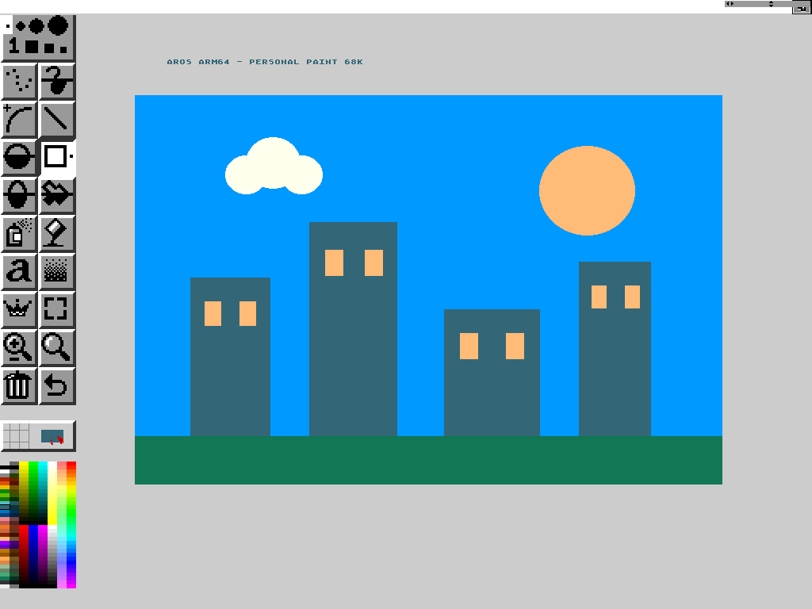

# Kaffeine: an open source home for the Amiga ecosystem

Kaffeine aims to preserve Amiga software across platforms and hardware
generations. AROS is the native operating system; `kaffeine.library` is the
compatibility infrastructure intended to let supported applications share
the same desktop, without a separately managed emulator or virtual machine.

**ARM64 is the first host. The 68k is the first guest environment.**
Other hosts and guest environments are long-term directions, with their
own CPU, ABI and platform requirements.

Read the [project manifesto](docs/kaffeine/MANIFESTO.md)
([original Italian](docs/kaffeine/MANIFESTO.it.md)) for the vision,
architectural boundaries and observable milestones.

## Current implementation

An [experimental Kaffeine JIT backend](docs/kaffeine/jit-backend.md) is now
selectable on standalone AROS AArch64 with `Set KAFFEINE_CPU jit`.

The current bridge runs 68k HUNK programs inside AROS AArch64 using Moira by default
as the CPU interpreter. Supported library calls reach native AROS services;
targeted graphics and system tests cover AROS windows, owned and public
screens (including 8-bit `LUT8` indexed screens on the Raspberry Pi
framebuffer driver), fonts, layers, regions, bitmaps, menus, gadgets,
cooperative guest child tasks (`AddTask`/`RemTask`), DOS packets and handler
ports, `ExAll`/`ExAllEnd`, and Workbench application objects. CLI programs,
the bzip2 1.0.8 self-test and the IJG JPEG library 9f self-test (`cjpeg`,
`djpeg`, `jpegtran`) run in QEMU. A standalone AArch64 translation probe runs
both on the host and inside native AROS AArch64 (`jit_probe`) as a step
toward the Kaffeine JIT, separate from the production AROS execution path.

The original 68k Personal Paint 7.2.1.0 opens from an icon on the native
AROS desktop in QEMU. The recorded session starts on a 24-bit Workbench,
selects a 1024×768, 256-color canvas inside Personal Paint, draws with
rectangles, circles and text, saves an IFF/ILBM image and returns to the
desktop. The decoded file matches the visible canvas pixel for pixel.
Icon launch uses the standard `CLI` tooltype and CPU blitting; the CPU
backend is Moira. Loading saved 1024×768 images, full Workbench `WBStartup`
handling and broader application compatibility remain open checks.

A separate [JIT smoke test](docs/kaffeine/jit-backend.md#validation) now
opens the same 68k editor from Shell and `Run`, draws a line and exits
normally. Saving and reloading images on the JIT remain to be validated;
the published video uses Moira.

PPC guests, RISC-V hosting, a general hybrid CPU backend and multicore
execution are future work. The manifesto does not claim them as implemented.

## Personal Paint demonstration — 28 October 2026

**[Watch the video (MP4, 3:41)](docs/kaffeine/media/personal-paint-2026-10-28/personal-paint-68k-aros-arm64.mp4)**
— [screenshots, saved drawing, setup and verified limits](docs/kaffeine/personal-paint-demo.md).

The capture starts directly in AROS and shows icon launch, drawing, saving
and return to the desktop. It contains only the guest display; idle waits
are shortened and drawing remains at its original speed. This is an AROS
ARM64/QEMU compatibility demonstration using Moira, rather than a JIT or
physical hardware benchmark.

## TurboText opening and input — 30 October 2026

The original 68k TurboText 2.0 now opens its editor, loads a text document and
visibly inserts a test character on AROS ARM64 with the Kaffeine JIT and a
24-bit Workbench. See the [framebuffer captures and checked scope](docs/kaffeine/media/turbotext-2026-10-30/README.md).
Native AROS screen-position and indexed-color conversion issues remain;
saving, reopening and broader editor behavior have not been accepted.

## Documentation and tests

- [Upstream m68kemu comparison and contribution candidates](docs/kaffeine/upstream-pr1905-comparison.md).
- [Personal Paint demonstration and downloadable media](docs/kaffeine/personal-paint-demo.md).
- [Current behavior, architecture and verified limits](README.KAFFEINE.md).
- [Host regression tests](developer/debug/test/kaffeine_host/README.md).
- [Bounded native backfill hooks](docs/kaffeine/native-backfill.md).
- [Tracked window refresh](docs/kaffeine/window-refresh.md) and [typed keyboard mapping](docs/kaffeine/keymap.md).
- [Standalone AROS AArch64 JIT probe](developer/debug/test/kaffeine_native/README.md).
- [AROS target programs and QEMU runner](developer/debug/test/kaffeine_target/README.md).
- [Library implementation](rom/kaffeine/README.md), [internals reference](rom/kaffeine/INTERNALS.md) and [CPU backend contract](rom/kaffeine/BACKENDS.md).
- [Licenses and provenance](docs/kaffeine/LICENSING.md).

The project builds on AROS and its original `m68kemu.library`. The bridge is
now `kaffeine.library` in `rom/kaffeine`. Emu68 remains a design reference;
its code is not included. Application software retains its own licenses.

## Upstream AROS documentation

The content below comes from the upstream AROS repository. References to
nightlies and CI services describe the upstream project.

---

# AROS Git Repository 

> This is the main repository for active development of the AROS Operating System.
> The repository contains the main Operating System components, SDK and Build System.

## Nightly Test Builds

* Builds are scheduled to run starting at 00:00 UTC. LLVM builds generally start 2hrs later.
* The builds are made using the scripts/azure-pipelines.yml file. Further details can be found in that file.
* GCC 6.5.0 builds are configured using default toolchain settings. Newer GCC builds may also use newer versions of binutils.
* The main AROS target and distfiles are built for each arch.
* The builds are downloadable via http://www.aros.org/nightly1.html .

<table>
  <tr>
    <td style="text-align:center">BUILD Arch</td>
    <td colspan=9 style="text-align:center"><em>Status</em></td>
  </tr>
  <tr>
    <td rowspan=2 style="text-align:center"><code>Toolchain</code></td>
    <td colspan=6 style="text-align:center">GNU</td>
    <td colspan=3 style="text-align:center">LLVM</td>
  </tr>
  <tr>
    <td style="text-align:center">6.5.0</td>
    <td style="text-align:center">9.5.0</td>
    <td style="text-align:center">10.5.0</td>
    <td style="text-align:center">13.5.0</td>
    <td style="text-align:center">15.2.0</td>
    <td style="text-align:center">16.2.0</td>
    <td style="text-align:center">11.0.0</td>
    <td style="text-align:center">20.1.0</td>
    <td style="text-align:center">23.1.0</td>
  </tr>
  <tr>
    <td>amiga-m68k</td>
    <td style="text-align:center">
      
    </td>
    <td style="text-align:center"> --- </td>
    <td style="text-align:center"> --- </td>
    <td style="text-align:center"> --- </td>
    <td style="text-align:center"> --- </td>
    <td style="text-align:center"> --- </td>
    <td style="text-align:center"> --- </td>
    <td style="text-align:center"> --- </td>
    <td style="text-align:center"> --- </td>
  </tr>
  <tr>
    <td>pc-i386</td>
    <td style="text-align:center">
      
    </td>
    <td style="text-align:center"> --- </td>
    <td style="text-align:center"> --- </td>
    <td style="text-align:center"> --- </td>
    <td style="text-align:center"> --- </td>
    <td style="text-align:center"> --- </td>
    <td style="text-align:center"> --- </td>
    <td style="text-align:center"> --- </td>
    <td style="text-align:center"> --- </td>
  </tr>
  <tr>
    <td>pc-x86_64</td>
    <td style="text-align:center"> --- </td>
    <td style="text-align:center"> --- </td>
    <td style="text-align:center"> --- </td>
    <td style="text-align:center"> --- </td>
    <td style="text-align:center">
      
    </td>
    <td style="text-align:center"> --- </td>
    <td style="text-align:center">
      
    </td>
    <td style="text-align:center"> --- </td>
    <td style="text-align:center"> --- </td>
  </tr>
  <tr>
    <td>pc-x86_64-smp</td>
    <td style="text-align:center"> --- </td>
    <td style="text-align:center"> --- </td>
    <td style="text-align:center"> --- </td>
    <td style="text-align:center"> --- </td>
    <td style="text-align:center"> --- </td>
    <td style="text-align:center">
      
    </td>
    <td style="text-align:center"> --- </td>
    <td style="text-align:center">
      
    </td>
    <td style="text-align:center"> --- </td>
  </tr>
  <tr>
    <td>raspi-armhf</td>
    <td style="text-align:center"> --- </td>
    <td style="text-align:center">
      
    </td>
    <td style="text-align:center"> --- </td>
    <td style="text-align:center"> --- </td>
    <td style="text-align:center"> --- </td>
    <td style="text-align:center"> --- </td>
    <td style="text-align:center">
      
    </td>
    <td style="text-align:center"> --- </td>
    <td style="text-align:center"> --- </td>
  </tr>
  <tr>
    <td>raspi-aarch64</td>
    <td style="text-align:center"> --- </td>
    <td style="text-align:center"> --- </td>
    <td style="text-align:center"> --- </td>
    <td style="text-align:center"> --- </td>
    <td style="text-align:center"> --- </td>
    <td style="text-align:center"> --- </td>
    <td style="text-align:center">
      
    </td>
    <td style="text-align:center"> --- </td>
    <td style="text-align:center"> --- </td>
  </tr>
  <tr>
    <td>raspi-aarch64-smp</td>
    <td style="text-align:center"> --- </td>
    <td style="text-align:center"> --- </td>
    <td style="text-align:center"> --- </td>
    <td style="text-align:center"> --- </td>
    <td style="text-align:center"> --- </td>
    <td style="text-align:center"> --- </td>
    <td style="text-align:center"> --- </td>
    <td style="text-align:center"> --- </td>
    <td style="text-align:center">
      
    </td>
  </tr>
  <tr>
    <td>sam440-ppc</td>
    <td style="text-align:center">
      
    </td>
    <td style="text-align:center"> --- </td>
    <td style="text-align:center"> --- </td>
    <td style="text-align:center"> --- </td>
    <td style="text-align:center"> --- </td>
    <td style="text-align:center"> --- </td>
    <td style="text-align:center"> --- </td>
    <td style="text-align:center"> --- </td>
    <td style="text-align:center"> --- </td>
  </tr>
  <tr>
    <td>opensbi-riscv64</td>
    <td style="text-align:center"> --- </td>
    <td style="text-align:center"> --- </td>
    <td style="text-align:center"> --- </td>
    <td style="text-align:center"> --- </td>
    <td style="text-align:center"> --- </td>
    <td style="text-align:center">
      
    </td>
    <td style="text-align:center"> --- </td>
    <td style="text-align:center"> --- </td>
    <td style="text-align:center">
      
    </td>
  </tr>
  <tr>
    <td>linux-i386</td>
    <td style="text-align:center">
      
    </td>
    <td style="text-align:center"> --- </td>
    <td style="text-align:center"> --- </td>
    <td style="text-align:center"> --- </td>
    <td style="text-align:center"> --- </td>
    <td style="text-align:center"> --- </td>
    <td style="text-align:center">
      
    </td>
    <td style="text-align:center"> --- </td>
    <td style="text-align:center"> --- </td>
  </tr>
  <tr>
    <td>linux-x86_64</td>
    <td style="text-align:center"> --- </td>
    <td style="text-align:center"> --- </td>
    <td style="text-align:center"> --- </td>
    <td style="text-align:center">
      
    </td>
    <td style="text-align:center"> --- </td>
    <td style="text-align:center"> --- </td>
    <td style="text-align:center">
      
    </td>
    <td style="text-align:center"> --- </td>
    <td style="text-align:center"> --- </td>
  </tr>
  <tr>
    <td>linux-arm</td>
    <td style="text-align:center"> --- </td>
    <td style="text-align:center">
      
    </td>
    <td style="text-align:center"> --- </td>
    <td style="text-align:center"> --- </td>
    <td style="text-align:center"> --- </td>
    <td style="text-align:center"> --- </td>
    <td style="text-align:center"> --- </td>
    <td style="text-align:center"> --- </td>
    <td style="text-align:center"> --- </td>
  </tr>
  <tr>
    <td>linux-armhf</td>
    <td style="text-align:center"> --- </td>
    <td style="text-align:center">
      
    </td>
    <td style="text-align:center"> --- </td>
    <td style="text-align:center"> --- </td>
    <td style="text-align:center"> --- </td>
    <td style="text-align:center"> --- </td>
    <td style="text-align:center"> --- </td>
    <td style="text-align:center"> --- </td>
    <td style="text-align:center"> --- </td>
  </tr>
  <tr>
    <td>darwin-i386</td>
    <td style="text-align:center"> --- </td>
    <td style="text-align:center"> --- </td>
    <td style="text-align:center">
      
    </td>
    <td style="text-align:center"> --- </td>
    <td style="text-align:center"> --- </td>
    <td style="text-align:center"> --- </td>
    <td style="text-align:center"> --- </td>
    <td style="text-align:center"> --- </td>
    <td style="text-align:center"> --- </td>
  </tr>
  <tr>
    <td>darwin-x86_64</td>
    <td style="text-align:center"> --- </td>
    <td style="text-align:center"> --- </td>
    <td style="text-align:center">
      
    </td>
    <td style="text-align:center"> --- </td>
    <td style="text-align:center"> --- </td>
    <td style="text-align:center"> --- </td>
    <td style="text-align:center"> --- </td>
    <td style="text-align:center"> --- </td>
    <td style="text-align:center"> --- </td>
  </tr>
  <tr>
    <td>darwin-ppc</td>
    <td style="text-align:center">
      
    </td>
    <td style="text-align:center"> --- </td>
    <td style="text-align:center"> --- </td>
    <td style="text-align:center"> --- </td>
    <td style="text-align:center"> --- </td>
    <td style="text-align:center"> --- </td>
    <td style="text-align:center"> --- </td>
    <td style="text-align:center"> --- </td>
    <td style="text-align:center"> --- </td>
  </tr>
  <tr>
    <td>mingw32-i386</td>
    <td style="text-align:center"> --- </td>
    <td style="text-align:center"> --- </td>
    <td style="text-align:center">
      
    </td>
    <td style="text-align:center"> --- </td>
    <td style="text-align:center"> --- </td>
    <td style="text-align:center"> --- </td>
    <td style="text-align:center"> --- </td>
    <td style="text-align:center"> --- </td>
    <td style="text-align:center"> --- </td>
  </tr>
  <tr>
    <td>mingw32-x86_64</td>
    <td style="text-align:center"> --- </td>
    <td style="text-align:center"> --- </td>
    <td style="text-align:center">
      
    </td>
    <td style="text-align:center"> --- </td>
    <td style="text-align:center"> --- </td>
    <td style="text-align:center"> --- </td>
    <td style="text-align:center"> --- </td>
    <td style="text-align:center"> --- </td>
    <td style="text-align:center"> --- </td>
  </tr>
</table>

## Incorporated components

AROS contains a number of projects that have been donated to the codebase, you can find links to them here.

*  - The de-facto standard retargetable audio system for AROS, AmigaOS, and MorphOS.

* [Poseidon](../master/rom/usb/README.md) - Modular USB host stack for Amiga-like systems.

## Contributing

Please see the [CONTRIBUTING.md](CONTRIBUTING.md) file for details on joining the GitHub organization, and guidelines on contributing to the AROS project.

## License

This project is licensed under the APL License - see the [LICENSE](LICENSE) file for details

## Acknowledgments

AROS contains parts built upon external components - see the [ACKNOWLEDGEMENTS](ACKNOWLEDGEMENTS) file for details

