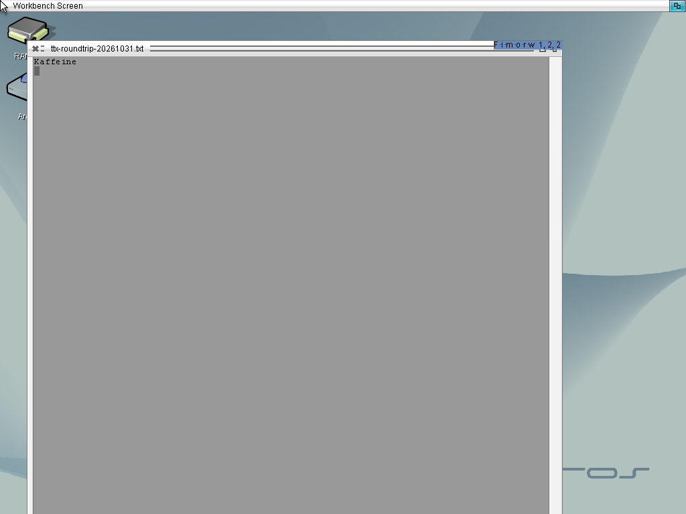
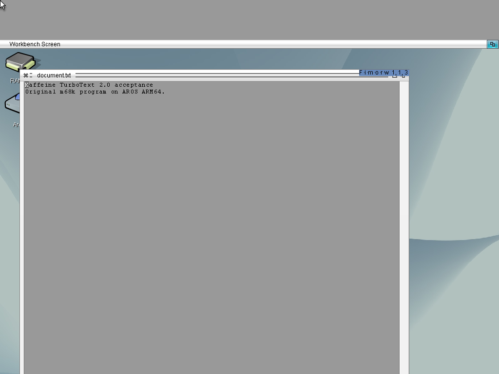

# Classic application checks on AROS ARM64

The unmodified 68k programs run through `kaffeine.library` on AROS ARM64.
Moira and the Kaffeine JIT are tested separately. Application binaries and
private test disk images are not distributed here.

| Program | Observed behavior | Scope and next check |
| --- | --- | --- |
| Redit 2.0 | Edit, save, quit, reopen, edit again and save with both Moira and JIT; extracted text files match the entered content | Both launches return 0; the JIT cycle was repeated after the full-index change. Further editor features remain unverified |
| Directory Opus 4.12 JR | Both Moira and JIT: opens on Workbench using ordinary preferences, copies a 73-byte text file and a 1024-byte binary file, renames the text, quits normally, reopens and lists both persisted files; extracted bytes match the sources. Shell and Run return 0 | The clock/date fields still display invalid values. Broader file operations and application features remain unverified |
| TurboText 2.0 | Original launcher and support libraries run unmodified. On a 24-bit Workbench, the Kaffeine JIT edits, saves, closes and reopens a new text file, then closes normally | Both original `WAIT` invocations return 0; first-save and final files match the nine entered bytes. Broader editing and indexed composition remain separate checks |
| AmiPixelShop 0.6.1-beta | Original release tested as `AmiPixelShop 64 64` with both backends; Shell and Run return 20 before opening the UI. Startup calls Exec `Alert()` with D7 `$00068881` | Startup is blocked. Inline FPU support is absent; P96 and screen-mode requester requirements are additional source-level gaps |

## Additional startup checks (2026-10-29)

### TurboText save and reopen (2026-10-31)

The [JIT demonstration video](turbotext-jit-demo.md) records a separate
99-byte named-file workflow through native AROS Execute and two original
`WAIT` invocations. Its caption strip reproduces the actual backend and
nonzero JIT counters from that session; both saved copies match after
shutdown. The earlier nine-byte test below remains a separate result.

The original TurboText 2.0 launcher and support libraries completed two
`WAIT` invocations with the Kaffeine JIT on AROS ARM64. On a 1024x768,
24-bit Workbench, the first editor typed `Kaffeine` and a newline, saved the
new document and closed. The second invocation visibly reloaded those bytes
without new input, then closed. Both returned 0 with empty standard error.
After shutdown, the first-save copy and final file each matched the expected
nine bytes, and all ten installed artifacts matched their staged hashes.

This required classic `PutDiskObject()` support through the guest Process's
native DOS broker and the correct 40-byte reservation for caller-built timer
requests. The old 48-byte reservation falsely rejected TurboText's adjacent
message port during close. Source checks, host regressions and the actual
application run are separate validation steps.



[Frames, artifact hashes and the exact test scope](media/turbotext-2026-10-31/README.md)
record the result. Broader editor features and a separate generic `Run`
invocation remain unverified by this workflow.

### TurboText progress (2026-10-30)

[TurboText 2.0](https://aminet.net/package/text/edit/TurboText20) is the
original freeware distribution by Martin Taillefer, written using M2Sprint
Modula-2. Its readme permits redistribution only as an unchanged archive;
the program and libraries are not included here. The readme recommends
manual installation because its old Installer script has compatibility
problems. Copy `Disk/Data` to an application drawer, then on the test system:

```text
Assign TurboText: Work:TurboText
Copy TurboText:Libs/turbotext.library LIBS:
Copy TurboText:Libs/ttxreqs.library LIBS:
Copy TurboText:Libs/ttxsupport.library LIBS:
CD TurboText:
TTX RAM:document.txt
```

The bundled `asl.library` and `amigaguide.library` were left in the original
drawer; the test system's native system libraries were retained. The
bridge successfully opens `TurboText:Libs/ttxsupport.library` as 68k code.
Initial Shell and Run trials with both Moira and JIT stopped at DOS
`CreateNewProc()` (LVO -498) with `ERROR_NOT_IMPLEMENTED`. That boundary now
has a typed implementation; the latest original-application follow-up uses
the Kaffeine JIT.

The [shared guest Process route](guest-processes.md) imports an owned 68k
HUNK with trusted relocation metadata into the same guest arena as its
parent. Each child has its own CPU, stack and guest Process, with a private
native DOS broker for streams, directories, CLI state and IoErr. The domain
keeps children and their shared data alive after the launcher returns.
Guest code remains 68k code; native workers enter only compiled bridge code.

The bounded startup trace identified ten active tags in the original
launcher's Shell and Run calls. Loaded modules and directory locks now use
typed guest identities rather than exposed native BPTR values:

| Tag | Observed value or relationship |
| --- | --- |
| `NP_StackSize` | 5000 bytes |
| `NP_Seglist` | The opaque guest token returned by the preceding `LoadSeg()`; the registry retains the full native BPTR privately |
| `NP_FreeSeglist` | `TRUE` |
| `NP_Name`, `NP_CommandName` | The same nonzero pointer; strings are not printed or followed by the trace |
| `NP_ConsoleTask`, `NP_WindowPtr` | `NULL` |
| `NP_CopyVars` | `FALSE` |
| `NP_Cli` | `TRUE` |
| `NP_HomeDir` | A nonzero typed directory-lock token; the trace does not dereference it |

No `NP_Entry` or `NP_Arguments` tag is present. Each list terminates after
ten items, within the diagnostic's 64-step and 16-output-item limits.
The loader trace records its native BPTR at full width and the delivered
32-bit D0 without reading segment contents or printing filenames. Logging
and converted-tag cleanup preserve the loader's IoErr.

The accepted 2026-10-30 application run uses the primary Kaffeine JIT on a
uniprocessor AROS ARM64 kernel in QEMU's Raspberry Pi 3 model. Workbench was
confirmed through native bitmap attributes as 1024x768, 24-bit. The original
launcher opens `document.txt`, displays both sample lines, and inserts a
delivered `j` at the cursor. The modified indicator and cursor column change
with the visible text. That run accepted opening, loading and input. The
2026-10-31 check below adds a separate save/close/reopen result.



[The input frame and run scope](media/turbotext-2026-10-30/README.md) record the
single-character check. Application and support-library binaries remain
unmodified; after shutdown, the installed application, emulator library and
native observation helpers matched their original artifacts. The run contains
no earlier bridge refusal or CPU fault.

The application now passes shared Process/IPC setup, ViewPortExtra and default
font queries, shared IDCMP ports, copied-RastPort `RectFill()` and `Text()` with
a translated classic TmpRas, and integer arithmetic inside LayerInfo scopes.
Its window-backfill Hook uses the [bounded native adapter](native-backfill.md).
File packets run in the [typed Process's DOS broker](guest-processes.md#typed-dos-packets).
The [tracked refresh scope](window-refresh.md) balances native window/update
locks, and [typed keymap conversion](keymap.md) translates classic keyboard
events before native mapping. Focused layer tests pass 37 groups and private
layer tests pass 31 groups, both normally and with ASan/UBSan. Native execution,
host regression and application acceptance remain separate evidence lanes.

The native
[`ScreenPosition()` implementation](../../rom/intuition/screenposition.c)
now implements `SPOS_MAKEVISIBLE` using the display aperture rather than
treating the rectangle coordinates as a relative move. The 2026-10-30
screenshots retain the earlier Workbench movement during caret updates.
On 2026-10-31, the native regression ran on AROS ARM64 in `raspi3b` QEMU with
a 1024x768, 24-bit Workbench. The original implementation reported 19 checks,
8 geometry failures and RC20. Replacing only `intuition.library` produced
21 checks, zero failures, zero skips and RC0, covering all 19 core cases
and both pulled-down-screen cases. The other 67 BSP members were unchanged.
This accepts the native geometry fix; it is separate from application
save/reopen acceptance.

An original native LUT8-to-truecolor
blit probe with distinct palettes copies the destination palette's colors
instead of the source's. The optimized
[CopyBox conversion](../../rom/hidds/gfx/gfx_hiddclass.c) selects the destination
bitmap's color map. The compositor uses that conversion for an indexed screen;
a separate native framebuffer probe observes black pixels after a screen move.
The 24-bit desktop permits the observed editor check; indexed composition
remains a separate native display limitation.

The original foreign-backfill controller passed **20 checks with zero failures**
through each of Moira and JIT on AROS ARM64. A separate native Process invoked
an installed Hook while the guest owner was blocked on CTRL_D. Both runs
changed a seeded pixel to the native reference value, delivered exactly the
guest signal, and completed observer retirement and cleanup. After VM shutdown,
the installed controller and library matched the host artifacts. These checks
validate the bounded callback and wake path; application editor acceptance
remains a separate gate.

### Independent-process prerequisite (2026-10-30)

The original `hunk_process_native` / `hunk_process_child` regression now
passes 27 checks in each Shell and Run invocation with both JIT and Moira
on AROS ARM64. The native parent loads two 68k modules and starts them
through native DOS. Both guest contexts reach a barrier while alive,
retain separate data and copied arguments, use distinct directories and
native streams, save separate results and return their expected exit codes.
After VM shutdown, the two 64-byte result files were extracted from each
disk image; their bytes match the expected records and agree between backends.

This validates overlapping process contexts on the current uniprocessor
guest. The parent keeps the emulator library open and waits for the native
owners to retire. The test deliberately uses native `CreateNewProc()`;
the supported guest route is covered separately by the original
[domain controller](../../developer/debug/test/kaffeine_target/domain_fixture_native.c)
and [68k HUNK generator](../../developer/debug/test/kaffeine_target/domain_fixture_hunks.c).
On the runtime containing the shared-port and default-font changes, this
controller passed **148 checks with zero failures**: 37 each through Moira
and JIT, from Shell and Run. After VM shutdown, all four 128-byte proof
records and eight original-HUNK comparisons were validated. These checks
exercise typed module transfer, guest Process identity and shared-domain
lifetime; they do not establish TurboText editor or UI acceptance.
The unavailable-emulator failure path remains separate from these successful
native launches.

### AmiPixelShop startup

[AmiPixelShop 0.6.1-beta](https://github.com/radi7777/AmiPixelShop/releases/tag/v0.6.1-beta)
is the untouched 68040/FPU release, using source tag
`84f224e4ce1ad83e5d3c74addd12268ddc8511df`. The `64 64` arguments choose a
small canvas, not the screen resolution. Tests used a 1024x768 AROS desktop,
the current 32-MB guest arena and a VM with networking disabled.

The first observed blocker is an Exec `Alert()` call (LVO -108), before
any P96 call or inline-FPU instruction fault. Its input D7 is `$00068881`
with both backends, consistent with the release's FPU requirement and the
bridge's FPU-free `AttnFlags`. The application returns 20 and writes no
application output; the improved unsupported-call diagnostic exposes this
input without changing the existing zero return or calling native Alert.

The [official sources](https://github.com/radi7777/AmiPixelShop/tree/84f224e4ce1ad83e5d3c74addd12268ddc8511df)
also establish later requirements that these failed launches did not test:

- `Picasso96API.library` v2, mode selection and `p96WritePixelArray()` with
  a classic `RenderInfo`. A CyberGraphics library-name alias cannot translate
  that interface.
- Inline FPU math, including transcendental operations, while initializing
  pixels and doing normal editing. Native math-library thunks do not provide
  an instruction-level FPU.
- A screen-mode requester with a guest filter hook on first start. A later
  minimal probe can use a valid saved RTG mode in `ENV:AmiPixelShop.prefs`.
- A requested 256-KB stack. The documented memory recommendation is 128 MB;
  there is no source-level 128-MB startup gate, so the current failure does
  not establish a memory-shortage diagnosis.

For a later offline GUI probe, preferences `mode=0x<valid RTG mode ID>` and
`updcheck=0`, on separate lines, avoid the mode requester and updater child.
They do not resolve the observed FPU/startup blocker. The small-canvas test
does not validate a complete document workflow or the documented memory floor.

The downloaded executable SHA-256 values identify the tested originals:

| File | SHA-256 |
| --- | --- |
| TurboText `TTX` | `262399d51c98c3c8498c12e2face18f31c79eb99e68a7a7d302b6b746b6d76c3` |
| AmiPixelShop | `71db861244ad496aa7cfa4f0c99cabe42f4cf3579ab77ab2a167affa64573a71` |

## Existing bridge regressions

The FileLock regression `dos_locks` passes 22 checks in each Shell and Run
invocation on native ARM64, Moira and JIT. It covers readable FileLock fields,
object/volume identity, directory and program-directory swaps, a bound assign,
DevProc, ParentDir, file-handle conversion and repeated acquisition/release.
The earlier bridge failed 7 of the original 18 checks; its opaque native lock
values made Directory Opus mistake two different drawers for the same object.

The production lock/heap host test passes 179 checks, including ASan/UBSan.
The complete host suite passes 48 executables. Handler and packet suites also
pass with ASan/UBSan. These are separate from the application checks above.

Broader APIs such as DosList manipulation, hard links, ReadLink and native
FontContents remain explicitly refused until their representations and
ownership have typed adapters. Passing these tests does not imply general
compatibility with every classic application or hardware-dependent software.

The post-copy port failure was traced to physical signal exhaustion: the
old bridge used four private native I/O signal bits in addition to the
application's ports/tasks. All native I/O requests now share one private
reply port. The 8-check signal-budget probe passes on native ARM64 and both
backends, while the previous bridge failed after three original opens.

The JIT startup stop was a 68020 full-format indexed `CLR.B` operand in
the original support library. The translator now implements the
non-indirect form, with separate host and AROS target regressions. The
application binary and support library were not patched for these tests.
