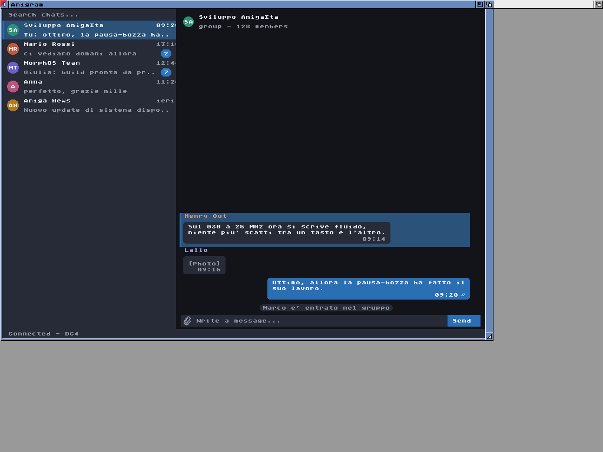

<!--
Copyright (C) 2026, The AROS Development Team. All rights reserved.
Author: Michele Dipace (@kaffeine1)
-->

# Amigram 0.1 sample screen on a locally patched AROS m68kemu.library

On 2026-11-14 the 68k release binary of
[Amigram](https://github.com/kaffeine1/telegram-amiga) 0.1 opened its
interface and exited normally on AROS ARM64 in QEMU, once from the Shell
and once through an actual `Run`. These are original 1024x768 guest frames.

**Everything in the Amigram window is sample data.** The program was
started with its `--gui-test` option, which opens the interface on a fixed
state compiled into the binary (`tg_gui_demo_state()` in its source). The
chat list, the names, the messages, the status line `Connected - DC4` and
the sentence about a 68030 at 25 MHz are that sample text. No account,
login, network connection or message was involved, and nothing here is a
speed measurement.

**This check did not use `kaffeine.library`.** The 68k program ran on a
locally patched AROS `m68kemu.library` with its Moira interpreter. The
local build reports version 1.5: AROS master `83449051` plus five
changes of mine that are not submitted upstream yet (requested root stack
size, Process streams, initial arguments, `GetArgStr`/`SetArgStr` and the
`AllocBitMap` result). The kernel and boot package were built from AROS
commit `50c69270` with local boot and link adjustments; they report
`exec.library` 51.17 and `dos.library` 50.89.

| Execution | Start | Return code | Frame with the window | Frame after exit |
| --- | --- | --- | --- | --- |
| Shell | Shell command | 0 | [Sample screen from Shell](amigram-shell.png) | [Desktop](desktop-after-shell-exit.png) |
| Run | actual `Run` | 0 | [Sample screen from Run](amigram-run.png) | [Desktop](desktop-after-run-exit.png) |

In each execution the window was captured 30 seconds after the start. One
Right Amiga+Q was then sent, only after the current frame equalled a
reviewed reference frame. The window closed, the program returned 0 with an
empty error stream, and the desktop frame was taken after that. No mouse
event and no typing in the message field were used.

The guest ran on QEMU's Raspberry Pi 3B model with one TCG thread and no
network device.

- Amigram 0.1 SHA-256: `b1040e9c67e73fadeaf0db72d301d3234b1f3159cb793db7fb675ca490655705`.
- `m68kemu.library` SHA-256: `e98c28788109e7ef1cc42350a357eac8fede62e8c3b0f6143e19a853d0fefd73`.

This accepts the appearance of the sample screen and a normal exit with
return code 0, separately from the Shell and from `Run`, on that locally
patched `m68kemu.library`. It does not establish login, an account, network
use, sending or receiving messages, the message field, performance,
`kaffeine.library` or its JIT, a complete current AROS system or physical
hardware.

The five `m68kemu.library` changes have focused host regressions. On the
same day I ran the four new ones from their Make targets, plain and with
ASan and UBSan, on separate source trees and on one combined tree: 64, 134,
63 and 121 checks, no failure with the changes and the expected failures
without them. Those changes and tests are not published yet, and none of
this is an upstream review.

Only the four original screenshots are included. Executables, disk images
and runtime logs are not distributed.

| File | Bytes | SHA-256 |
| --- | --- | --- |
| amigram-shell.png | 13,899 | `d8f19b7d4ed911c6f7ae26dbeae47c238beaa15a35f989872506c0589bc88ad3` |
| amigram-run.png | 13,374 | `61a0a10dbaae53642a311cad80bcb69e12206914751e276112c6fff16e86547e` |
| desktop-after-shell-exit.png | 5,484 | `931fb8708306103e8f3f42b932d9a460a2e0704b0af26843a6e70d058918a727` |
| desktop-after-run-exit.png | 5,478 | `3ab369f8a6f7e17c776c2c33f0ff545b2eb18492b30f69058fbc86fac119fd31` |
