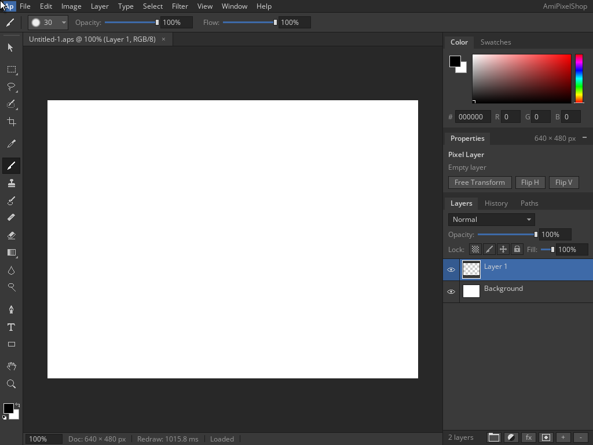

<!--
Copyright (C) 2026, The AROS Development Team. All rights reserved.
Author: Michele Dipace (@kaffeine1)
-->

# AmiPixelShop 68k save and reopen on AROS ARM64

On 2026-11-01 UTC, a 68020 source build of AmiPixelShop 0.6.1 without an FPU
saved and reopened a layered document through the Kaffeine JIT in QEMU's
Raspberry Pi 3 model, using one TCG worker. The confirmed Workbench mode was
1024x768, 24-bit (`0x00100000`); the document was 640x480.

The Shell execution opened Save As, accepted `Work:Untitled-1.aps`, displayed
“Saved” and closed. A fresh execution through actual `Run` opened the same
file through ASL, displayed “Loaded” with a single `Untitled-1.aps` tab and
closed. Both returned 0 with empty standard error. Native observations
confirmed requester closure and screen exit; the trace recorded two Kaffeine
JIT starts, two completed translation-statistics records and no unimplemented
call. All ten requested steps completed in order, with each screenshot saved
before the next key input.

## Frames

1. [Save As with the default filename](save-dialog.png)
2. [Saved document](saved.png)
3. [Open listing the saved file](open-dialog.png)
4. [Reloaded document](reopened.png)

## Saved file

[Download the actual two-layer APX1 document](two-layer-640x480.aps).
After the VM stopped, the extracted file was independently decoded and
matched the observed 2,259-byte saved size:

- APX1 version 3; 640x480; two layers; active layer 1.
- Background: 80 present 64x64 tiles, all pixels opaque white, including
  padding below the visible canvas; normal blend, full opacity and visibility.
- Layer 1: empty, normal blend, full opacity and visibility.
- Exact stream termination and end of file, with no extra chunks.

The 640x480 RGBA canvas SHA-256 is
`f7f3eed6bad2c170eb0bccd6c368b320688a207a59c27321b412dd0774bc4df1`.
This blank-document check establishes the save/reopen path. A later
[coloured-stroke check](../amipixelshop-colour-2026-11-01/README.md) adds drawing,
APX1 pixel validation and exact saved/reopened canvas RGB comparison. Other
formats, mode selection, Moira and physical hardware remain additional checks.
A separate Open/Cancel check also passed from both Shell and Run. `Work:` was assigned to a new empty drawer before either test.

## Artifact identity

The tested source-built 68k executable SHA-256 is
`14f5d373e46d5665f89f08eb827caf33949346761d44b69fdf516c2ebbbdab4d`.
The tested `kaffeine.library` SHA-256 is
`8af7929c322e4c7a06342a48a24eec97d61945fe8098cd88f9b02c174ff519ce`.
Application binaries and VM disk images are not included.

| File | SHA-256 |
| --- | --- |
| open-dialog.png | `fbc71920fb4f5103ddd628567dd449e3c8a4a5f1ba923b73477307bc1a25b47a` |
| reopened.png | `df64d0d28542a820d0767d7b573ca9de995d16eadd83d65acef2004d7307da00` |
| save-dialog.png | `88c12b6e1bc8eca9daa651062b211dcbe86fc171d6226660ca93e955b9b50867` |
| saved.png | `41bc8224f4c7e349b9cb1110409adb3b5e28955a52fb69a3d85737d112ee4ca2` |
| two-layer-640x480.aps | `f9afbc6b3f2fc22c4796535a8d234c8a0217b30ff68f32af736f26b6ef38af9d` |

AmiPixelShop is by radi7777. The source checkout used for this build carries
the [MIT license and copyright notice](AmiPixelShop-LICENSE.txt), retained
unchanged here. These frames show the source-built 68k variant; the original
release's FPU startup result is documented separately in
[classic application checks](../../classic-applications.md).
