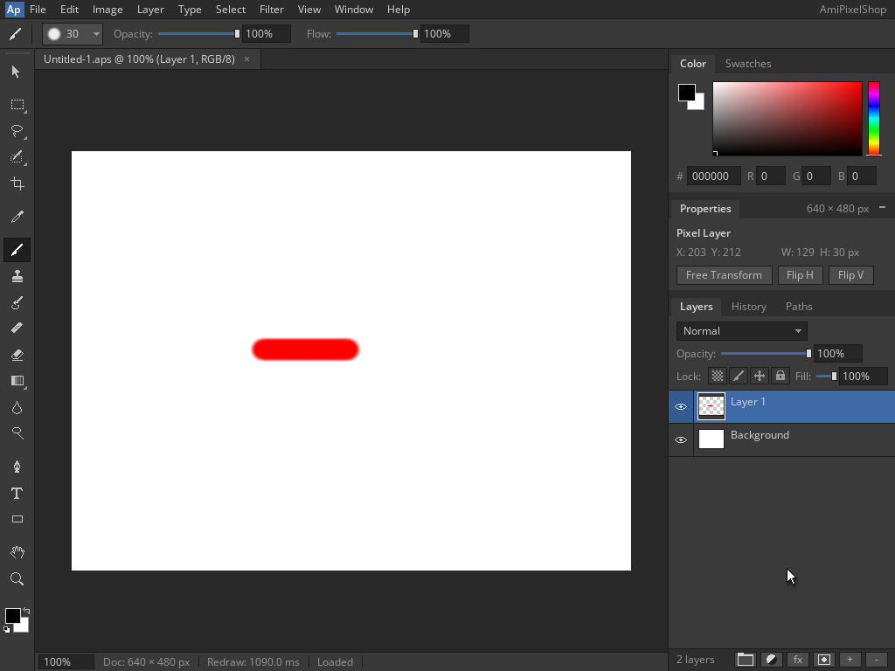

<!--
Copyright (C) 2026, The AROS Development Team. All rights reserved.
Author: Michele Dipace (@kaffeine1)
-->

# AmiPixelShop 68k coloured-stroke save and reopen on AROS ARM64

On 2026-11-01 UTC, AmiPixelShop 0.6.1 built for a 68020 without an FPU
painted a red brush stroke, saved it from Shell and reopened it through
actual `Run`, using the Kaffeine JIT on AROS ARM64 in QEMU's Raspberry Pi 3
model. This extends the [blank-document check](../amipixelshop-2026-11-01/README.md).
Workbench and the application's own screen were 1024x768, 24-bit; the document
was 640x480 at 100% zoom. QEMU used one TCG worker.

## Frames

1. [Red selected: R 255, G 0, B 0](red-selected.png)
2. [Stroke painted on Layer 1](red-stroke.png)
3. [Save As](save-dialog.png)
4. [Saved coloured document](saved.png)
5. [Open listing the saved file](open-dialog.png)
6. [Loaded coloured document in the fresh Run execution](reopened.png)

The brush size was 30, with 100% opacity and flow. The stroke was drawn from
canvas (218,227) to (318,227). Both Saved and Loaded show one `Untitled-1.aps`
tab and the same Properties bounds: X 203, Y 212, W 129, H 30. The cursor was
parked outside the canvas before capture. The fresh execution resets the
foreground colour to black; the red pixels in the reopened document persist.
Both executions returned 0 with empty standard error and closed cleanly.
The trace recorded two Kaffeine JIT starts, two completed translation-counter
records and no unimplemented call.

## Saved file and pixel checks

[Download the actual red-stroke APX1 document](red-stroke-640x480.aps).
The 3,258-byte file was extracted after VM shutdown. Independent decoding
verified APX1 version 3, 640x480, two layers, active layer 1 and exact end of
file. All 80 Background tiles, including padding, remain opaque white.
Layer 1 contains exactly tiles 33, 34 and 35, with 3,658 nonzero-alpha pixels,
1,916 opaque pixels and 1,742 soft-edge pixels. Their bounds are
(203,212)..(331,241), inclusive.

Every stored stroke pixel matches the application's integer colour law for
nominal red. In particular, its opaque core stores RGBA (254,0,0,255): the
application's reciprocal-table arithmetic rounds the selected R 255 to 254.
Transparent pixels remain zero. The continuous core row, stroke bounds and
pixel counts were checked separately.

The 640x480 RGB canvas regions of `saved.png` and `reopened.png` are exactly
byte-identical. Both also match the RGB composite independently calculated
from the decoded layers, using the application's blend arithmetic over white.
The 921,600-byte RGB SHA-256 is
`e6dd7bdbed0fd204fb9613bb96a53518c4472b7dedc7dba7d351341e815c96e0`.

This establishes one coloured brush stroke persisting through APX1 Save As,
exit and fresh Run Open. It does not cover other tools, all brush shapes,
PNG/JPEG/IFF workflows, the first-start mode requester, Moira or physical
hardware. The tested executable is a source-built 68020 variant; the original
FPU release's startup result remains separate.

## Artifact identity

The source-built 68k executable SHA-256 is
`14f5d373e46d5665f89f08eb827caf33949346761d44b69fdf516c2ebbbdab4d`.
The unchanged `kaffeine.library` SHA-256 is
`8af7929c322e4c7a06342a48a24eec97d61945fe8098cd88f9b02c174ff519ce`.
Application binaries and VM disk images are not included.

| File | SHA-256 |
| --- | --- |
| open-dialog.png | `e08ac79eed6411c18634f95729920b5d7ae020a80c434865c90545d3440bb5ff` |
| red-selected.png | `44c36aacaa9f263496b30c4f1cdc9e57ab434e630331661f6451e21e5f4dd1b0` |
| red-stroke-640x480.aps | `3f460499911e4929877811ee75bb67e37c89e8628337af207d0099d253ba32f6` |
| red-stroke.png | `571f64c6f76eea6bc1f5371df5a0b52e8cc3a9eb3f9b8fb44e2121bf0968f666` |
| reopened.png | `3cf961678604b47f169f36c22fd6833f2e6fbb3cbcf9c1d50a3319a4a23a0318` |
| save-dialog.png | `cc934a4a08d92e744aa507671af2368a2b21a15328985c3193849e522dda1cb0` |
| saved.png | `6069d8eb480d54e3dd9e083cc5b646d373c90a2757416f445c8d48027ffd8040` |

AmiPixelShop is by radi7777; its original
[MIT license and copyright notice](../amipixelshop-2026-11-01/AmiPixelShop-LICENSE.txt)
are retained unchanged. See [classic application checks](../../classic-applications.md)
for the wider compatibility scope.
