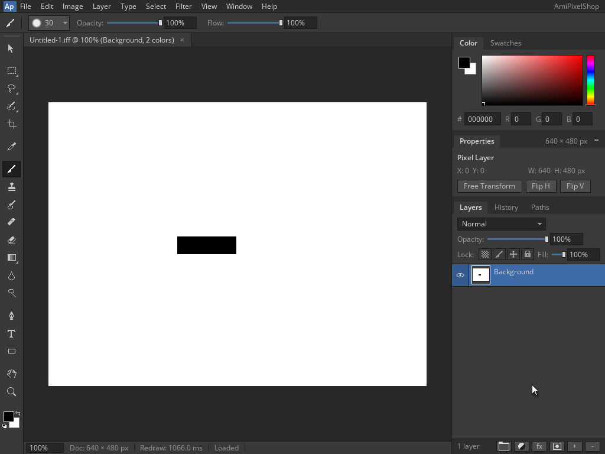

<!--
Copyright (C) 2026, The AROS Development Team. All rights reserved.
Author: Michele Dipace (@kaffeine1)
-->

# AmiPixelShop 68k IFF save and reopen on AROS ARM64

On 2026-11-02 UTC, AmiPixelShop 0.6.1 built for a 68020 without an FPU
saved a black rectangle as IFF/ILBM from Shell and reopened it through actual
`Run`, using the Kaffeine JIT on AROS ARM64 in QEMU's Raspberry Pi 3 model.
Workbench and the application's screen were 1024x768, 24-bit; the document
was 640x480 at 100% zoom. QEMU used one TCG worker.

This adds a fixed two-colour indexed IFF check to the
[opaque Background RGB PNG workflow](../amipixelshop-png-2026-11-02/README.md).
The 24-bit screen and the IFF's one-bitplane image are separate properties.

## Frames and saved IFF

1. [Black rectangle on one white Background](drawing.png)
2. [Save As before changing .aps to .iff](save-dialog.png)
3. [Saved IFF, with the working document still RGB/8](saved.png)
4. [Open listing the 1,274-byte IFF](open-dialog.png)
5. [Loaded IFF, one Background and 2 colors](reopened.png)

[Download the actual 640x480 IFF/ILBM](black-rectangle-640x480.iff).

The empty Layer 1 was merged into the white Background before drawing.
A rectangular selection covered document coordinates `[218,318) x [227,257)`:
100x30 pixels. Fill with the default black foreground and then deselect
produced exactly 3,000 black pixels and 304,200 white pixels. The cursor was
parked outside the canvas before capture.

Save As changed `Untitled-1.aps` to `Untitled-1.iff`. The application displayed
Saved, exited, and displayed Loaded after Open in the fresh `Run` execution.
Both executions returned 0 with empty standard error and closed cleanly.
The trace records the Kaffeine JIT backend twice, with 4,343 blocks / 22,263
translated instructions for Shell and 2,695 / 13,119 for Run. Translation
counters identify these executions; they are not a performance benchmark.

## File and pixel validation

After shutdown, the actual saved file passed these checks:

- Exactly 1,274 bytes: big-endian FORM size 1,266, type ILBM, exact EOF.
- Ordered BMHD (20 bytes), CMAP (6), CAMG (4) and BODY (1,200).
- BMHD: 640x480, one plane, no mask, ByteRun1 compression, origin 0,0,
  aspect 10:11 and page 640x480. CAMG is `0x00008004`.
- Palette: black at index 0 and white at index 1.
- All 480 planar rows decode to exactly 80 bytes, without crossing row
  boundaries, truncated runs or trailing BODY data; horizontal bits are MSB first.
- Decoded RGB equals an independently generated black rectangle on white.
  The reference uses only the fixed geometry and colours, with no prior JIT
  image or pixels taken from the IFF.
- Drawing, saved and reopened canvas regions `(82,173)..(722,653)` (exclusive
  right/bottom) are byte-identical and match the decoded IFF and reference.

The 921,600-byte RGB SHA-256 shared by the decoded IFF, all three canvas
regions and the independent reference is
`344602ac31d99c85fc75c94ac3b2747ccc63b1a335341c5cd789670b73731ce9`.
The whole IFF also matches the byte sequence predicted from the writer's
source before the VM run. File structure, independent pixel geometry and
visible UI state were checked separately.

## Scope and identity

This establishes a lossless roundtrip for this opaque, two-colour fixture,
including rectangle selection, black fill, deselection, IFF Save As and
fresh Run Open. The exporter quantizes RGB documents to a palette; it does
not write 24-plane ILBM. Arbitrary multicolour or soft-edged RGB artwork may
change through quantization. This result does not establish lossless RGB
IFF export generally, transparency, multilayer preservation or other tools.
The original FPU release, Moira and physical hardware remain separate checks.
A [160x120 JPEG workflow](../amipixelshop-jpeg-2026-11-02/README.md) has its own
lossy-file and scalar CPU comparison.

The application and library are unchanged from the APX1 and PNG checks:

- AmiPixelShop SHA-256:
  `14f5d373e46d5665f89f08eb827caf33949346761d44b69fdf516c2ebbbdab4d`.
- `kaffeine.library` SHA-256:
  `8af7929c322e4c7a06342a48a24eec97d61945fe8098cd88f9b02c174ff519ce`.

The VM is closed. Only the original frames and saved IFF are included;
application binaries and disk images are not distributed.

| File | SHA-256 |
| --- | --- |
| black-rectangle-640x480.iff | `baa8f952e25c72a737f219552599bc41f571712a5b476c9bc15dbc6f86877a25` |
| drawing.png | `d32e5d62949603ac77ab894510bb9fb1254242d79367637e1e481675ab27c878` |
| open-dialog.png | `6253871f8558b0f12c36c88be2e85aab2d47cb24723d2eb0b15350cd08117112` |
| reopened.png | `19c6ff9fb76c8f1e754cff88c36935e584663eca714ad0bafb0e5adeb5af1dd3` |
| save-dialog.png | `f7c2659661426752391efc2458001b9afe75bf7beac6e06436504a2a63f4d36b` |
| saved.png | `b29e673b63637938c0c17468ec9d034cebef202e5d8e950e77f7b20c415190ed` |

AmiPixelShop is by radi7777; its original
[MIT license and copyright notice](../amipixelshop-2026-11-01/AmiPixelShop-LICENSE.txt)
are retained unchanged.
