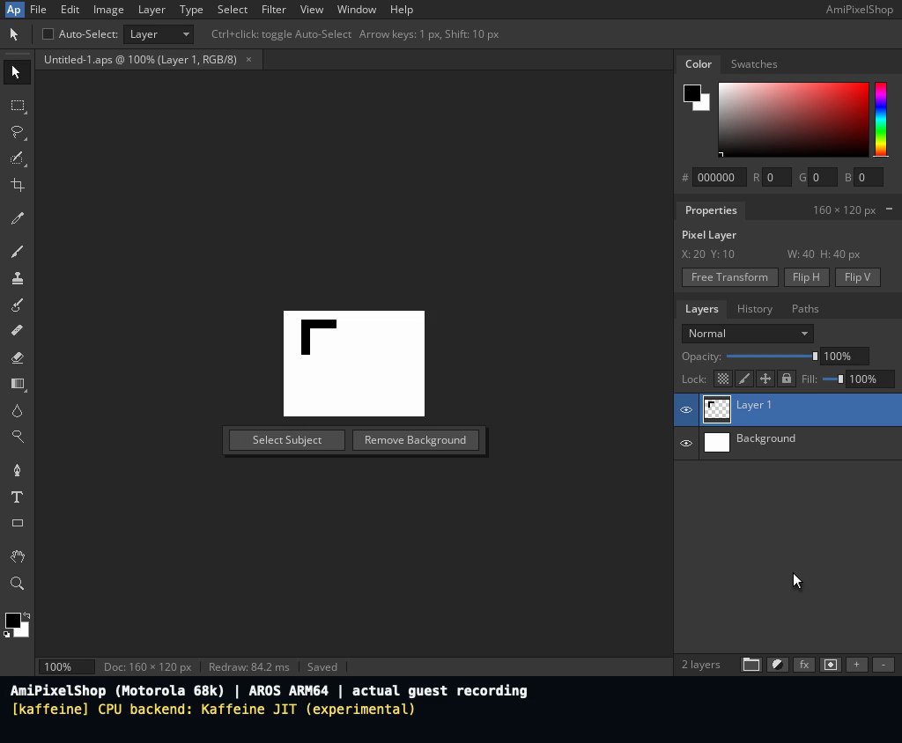

<!--
Copyright (C) 2026, The AROS Development Team. All rights reserved.
Author: Michele Dipace (@kaffeine1)
-->

# AmiPixelShop 68k with the Kaffeine JIT on AROS ARM64

**[Watch or download the video (MP4, 2 min 20 s)](amipixelshop-68k-kaffeine-jit-aros-arm64.mp4)**

Recorded on 2026-11-02. AmiPixelShop 0.6.1, built for a Motorola 68020
without an FPU, starts from the native AROS desktop, draws, saves a layered
project, closes, reopens it in a fresh process, edits the loaded layer and
saves again. Kaffeine's own JIT executes the 68k application inside AROS ARM64.
Workbench and the application screen are 1024x768, 24-bit.

The video starts directly on AROS, with no introductory card or host window
borders. Two real desktop project icons use the standard `CLI` tooltype
and native `C:Execute`: the first script invokes AmiPixelShop directly;
the second starts a fresh actual `Run` invocation. This demonstrates the
native CLI icon route; it does not establish 68k `WBStartup` support.
Both application invocations return 0 with empty standard error and close
normally with Ctrl+Q, without a Quit requester.

The 160x120 document keeps a white `Background` and transparent `Layer 1`.
Two black rectangle fills make an asymmetric 700-pixel L. Native Save As
writes `Work:Untitled-1.aps`; after reopening that same APX1 project, the
Move tool and Shift+Right translate the loaded foreground ten pixels right.
Ctrl+S resaves the existing path and clears the modified tab. Independent
checks confirm both saved layer states and all five captured canvas states,
including the preserved transparency and unchanged white background.

The live guest was sampled at a 5 fps target rate. The H.264 delivery runs
at 24 fps, repeating captured frames. Idle waits were removed in chronological
order; retained actions keep their captured timing. A separate 76-pixel strip
below the full guest framebuffer reproduces UART messages from this same
session, only after those messages were observed. Backend banners appear on
launch and completion counters after each invocation finishes:

| Invocation | JIT blocks | Translated instructions | Entries |
| --- | --- | --- | --- |
| First icon, direct CLI | 4072 | 20623 | 3308169 |
| Second icon, fresh Run | 3846 | 19472 | 3205157 |

These identify the recorded CPU contexts, not an aggregate for every child
Process or a speed benchmark. Moira was not used in this recording.

This checks the named two-layer workflow on a uniprocessor AROS guest in
QEMU's Raspberry Pi 3 model with one TCG worker. The original FPU
release, other tools/formats and physical hardware remain separate checks.
See the [classic application notes](../../classic-applications.md) and the
[earlier layered-project proof](../amipixelshop-layered-project-2026-11-02/README.md).

- AmiPixelShop SHA-256: `14f5d373e46d5665f89f08eb827caf33949346761d44b69fdf516c2ebbbdab4d`.
- `kaffeine.library` SHA-256: `dd793fa9196d3ff28df8256c0663f13010ba61a8b64b59509759aafc5a68b450`.
- Library source: `70e2f781b15392216afa669c005ecfa750b4abd9`.

The MP4 is 1024x844, 24 fps and 140.333 seconds. The preview is a decoded frame of this delivery.

| File | Bytes | SHA-256 |
| --- | --- | --- |
| amipixelshop-68k-kaffeine-jit-aros-arm64.mp4 | 1,067,184 | `ec3af720649a320f9e477f19c335402195063189a5ab5d92287cc4eaeac6a8be` |
| amipixelshop-jit-preview.png | 126,600 | `73029417e23ea05f557a0c7f2ffb6a3d20d0fd093b35bd05426f19b315aeb23b` |

AmiPixelShop is by radi7777; its original
[MIT license and copyright notice](../amipixelshop-2026-11-01/AmiPixelShop-LICENSE.txt)
are retained unchanged.
