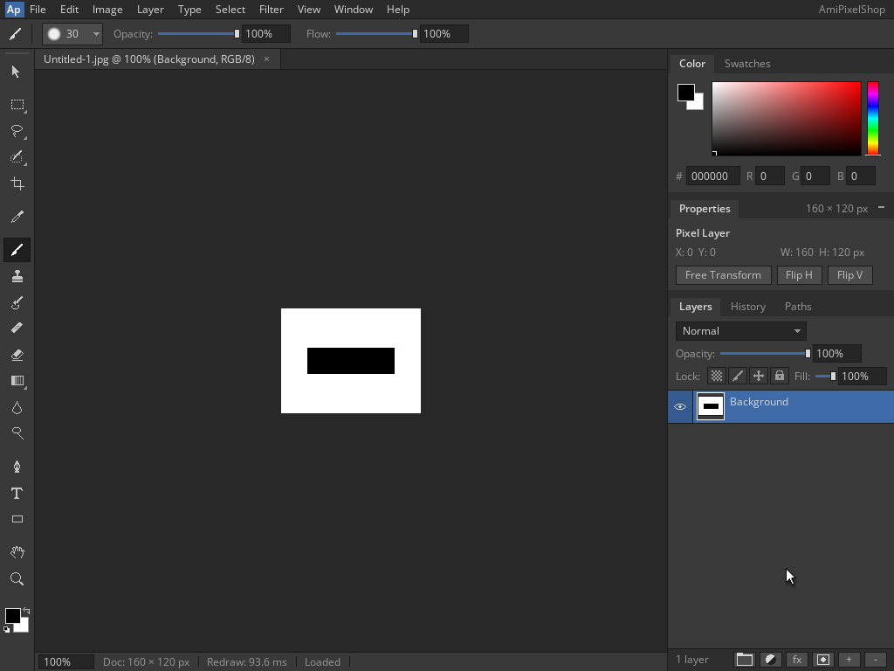

<!--
Copyright (C) 2026, The AROS Development Team. All rights reserved.
Author: Michele Dipace (@kaffeine1)
-->

# AmiPixelShop 68k JPEG save and reopen on AROS ARM64

On 2026-11-02 UTC, AmiPixelShop 0.6.1 built for a 68020 without an FPU
saved a black rectangle as JPEG from Shell and reopened it through actual
`Run`, using the Kaffeine JIT on AROS ARM64 in QEMU's Raspberry Pi 3 model.
Workbench and the application's screen were 1024x768, 24-bit. The document
was 160x120 at 100% zoom; QEMU used one TCG worker.

This adds a lossy format check to the [RGB PNG](../amipixelshop-png-2026-11-02/README.md)
and [indexed IFF](../amipixelshop-iff-2026-11-02/README.md) workflows. The
smaller document bounds this first JPEG check; the display remains 24-bit.

## Frames and saved JPEG

1. [Black rectangle on one white Background](drawing.png)
2. [Save As before changing .aps to .jpg](save-dialog.png)
3. [Saved JPEG; the working document still holds the original pixels](saved.png)
4. [Open listing the 1,709-byte JPEG](open-dialog.png)
5. [Loaded JPEG in the fresh Run execution](reopened.png)

[Download the actual 160x120 JPEG](black-rectangle-160x120.jpg).

The empty Layer 1 was merged into the white Background before drawing.
A rectangular selection covered document coordinates `[30,130) x [45,75)`:
100x30 pixels. Black fill and deselection produced exactly 3,000 black
pixels and 16,200 white pixels. The cursor was parked outside the canvas.

Save As changed `Untitled-1.aps` to `Untitled-1.jpg`. The application displayed
Saved, exited, and displayed Loaded after Open in the fresh `Run` execution.
Both executions returned 0 with empty standard error and closed cleanly.
Each trace identified the Kaffeine JIT: 4,064 blocks / 19,813 translated
instructions for Shell and 3,164 / 15,921 for Run. These counters identify
the executions; they are not a performance benchmark.

## File and pixel validation

After shutdown, the actual saved file passed these checks:

- Exactly 1,709 bytes: JFIF 1.01, 160x120 baseline 8-bit JPEG, quality 90,
  4:2:0 sampling and the writer's expected quantization and Huffman tables.
- The 607-byte header, complete entropy scan and EOI at exact EOF are valid.
  All 80 MCUs / 480 blocks (320 Y, 80 Cb, 80 Cr) pass Huffman syntax,
  category/run bounds, byte stuffing and terminal padding checks.
- Drawing and saved canvas regions `(322,353)..(482,473)` (exclusive
  right/bottom) match an independent uncompressed geometric reference.
- The reopened region matches exactly the 57,600 RGB bytes decoded on the
  host with the same scalar STB decoder sources and four-channel output
  configuration as the application's loader, after checking opaque alpha.
  No prior JIT image supplies the expected decoded pixels.

The drawing/saved/reference RGB SHA-256 is
`4492ff3a9967713dd9148f8014390bc8a873e5eaf0bb7046fdc8ce920a1c0078`.
The host-decoded JPEG and reopened RGB SHA-256 is
`c6e1b3b215b7d31c8ff00549148e2cca052e0a3fc09089dab850776a1eccc1b9`.

JPEG changes 408 of the 19,200 source pixels, with a maximum absolute
channel difference of 8 on the 0..255 scale. The saved working canvas
retains the original pixels; the fresh reload displays the lossy JPEG.
The reopened comparison uses zero tolerance against the CPU decode,
rather than requiring a lossy export to equal its uncompressed source.
A host encode from the independent source geometry also produced the same
whole JPEG bytes in this case. That observation does not guarantee encoder
byte identity for other images or floating-point paths.

## Scope and identity

This covers one opaque Background, rectangle selection, black fill,
deselection, JPEG Save As and fresh Run Open for this 160x120 fixture.
Other JPEG sizes and artwork, transparency, layered export, other tools,
the original FPU release, Moira and physical hardware remain separate checks.
The executable and library are unchanged from the APX1, PNG and IFF checks:

- AmiPixelShop SHA-256:
  `14f5d373e46d5665f89f08eb827caf33949346761d44b69fdf516c2ebbbdab4d`.
- `kaffeine.library` SHA-256:
  `8af7929c322e4c7a06342a48a24eec97d61945fe8098cd88f9b02c174ff519ce`.

The VM is closed. Only the original frames and actual saved JPEG are
included; application binaries and disk images are not distributed.

| File | SHA-256 |
| --- | --- |
| black-rectangle-160x120.jpg | `c7af78b66fdccaf6dc9c0a82333f95cd8b14c6c6b763c860efee3901ce9bcca3` |
| drawing.png | `52fe488509f6fc2cf55341bd2632a09944cf5f9902be9af8f473b0f9abb00196` |
| open-dialog.png | `df9104b7deb6c58164c04b6edb3af1752c7e660fd1b54ad1d020667996a62c68` |
| reopened.png | `8a1806278c70a9580e6f3d1ea353585fda094745302e616cda7c0811854620a8` |
| save-dialog.png | `5aab98c05a49c2ece9fe9e7ded470bfd87482d0701c8027161d482fab9469229` |
| saved.png | `3b258105e4e315ca86f477e31a4fba2601fc7f37558251437b8267d38afe685a` |

AmiPixelShop is by radi7777; its original
[MIT license and copyright notice](../amipixelshop-2026-11-01/AmiPixelShop-LICENSE.txt)
are retained unchanged.
