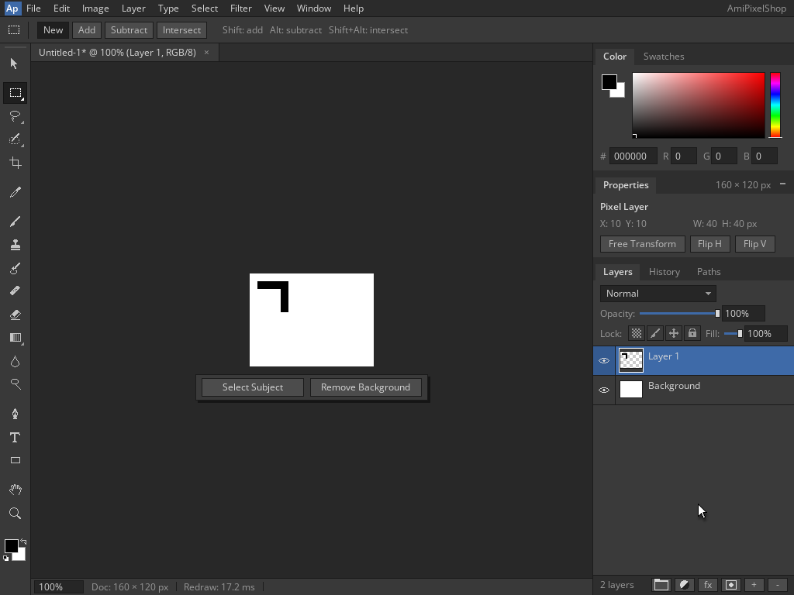

<!--
Copyright (C) 2026, The AROS Development Team. All rights reserved.
Author: Michele Dipace (@kaffeine1)
-->

# AmiPixelShop 68k horizontal layer flip on AROS ARM64

On 2026-11-02 UTC, AmiPixelShop 0.6.1 built for a 68020 without an FPU
completed a horizontal layer flip with the Kaffeine JIT on AROS ARM64 in
QEMU's Raspberry Pi 3 model. A fresh Shell execution and a fresh actual
`Run` repeated the same workflow. Both returned 0 with empty standard
error and closed normally through the native Quit dialog.

This follows the [Move, Undo and Redo check](../amipixelshop-redo-2026-11-02/README.md)
with the same executable and library. Workbench and the application screen
were 1024x768, 24-bit. Each document was 160x120 at 100% zoom; QEMU used
one TCG worker.

## Original frames

| State | Shell | Fresh Run |
| --- | --- | --- |
| Painted L before Flip H | [Baseline](baseline-shell.png) | [Baseline](baseline-run.png) |
| Horizontal flip within layer bounds | [Flipped](flipped-shell.png) | [Flipped](flipped-run.png) |
| Native unsaved-changes Quit dialog | [Quit](quit-shell.png) | [Quit](quit-run.png) |

Each fresh document keeps its white Background and initial transparent
Layer 1. Two rectangle selections, black fills and deselections paint an
asymmetric L on Layer 1. Clicking **Flip H** in the Properties panel flips
the content within its own bounds. The stem moves from left to right;
the top bar stays in place. The selection is cleared before the flip,
and the layers remain separate. No additional Apply or Enter is needed.
Ctrl+Q opens the native Quit dialog, and Left Amiga+V confirms Quit.
Both application screens close with real application return code 0.

## Independent pixel validation

After shutdown, the canvas region `(322,353)..(482,473)` (exclusive
right/bottom) in all four state PNGs was decoded and compared with
references built directly from fixed coordinates:

- Common top bar: black at `[10,50) x [10,20)`.
- Baseline stem: black at `[10,20) x [20,50)`.
- Flipped stem: black at `[40,50) x [20,50)`.
- White everywhere else: 700 black pixels, 18,500 white pixels and
  57,600 RGB bytes in every canvas.
- Exactly 600 pixels change: 300 vacated stem pixels become white and
  300 new stem pixels become black. Both executions match with zero
  tolerance.

The content bounds are `[10,50) x [10,50)`, so the horizontal source map
is `x_source = 59 - x_destination`. The asymmetric shape and offset
bounds distinguish the selected flip from a missing flip, a vertical
flip or a flip of the whole 160-pixel-wide canvas. A uniform rectangle
would remain unchanged when flipped within its own bounds.

No captured frame supplies the expected pixels. The reference and actual
baseline RGB SHA-256 is
`e68e0231b2abf21cd4bf475489653508b0c80bff7273b8e62d26773294565b83`.
The reference and actual flipped RGB SHA-256 is
`24c6886947fbdd758027a813062f47bc51dcf65ad94d1ad4a42f01e9589ac119`.

Both execution traces identify the Kaffeine JIT and record 3,899 blocks /
18,740 translated instructions. These counters identify the executions;
they are not a performance benchmark.

## Scope and identity

This checks one horizontal layer flip and native Quit for the selected
two-layer opaque composite in both launch modes. It does not establish
arbitrary transforms, selections during transforms, transparency editing,
the original FPU release, Moira or physical-hardware compatibility.
No file save was part of this session; the separate format checks cover
save and reopen. The later [layered project roundtrip](../amipixelshop-layered-project-2026-11-02/README.md)
adds APX1 Save As, fresh Run Open, a ten-pixel layer move and Ctrl+S resave
of the existing path, with separate-layer RGBA and both saved files checked.

- AmiPixelShop SHA-256:
  `14f5d373e46d5665f89f08eb827caf33949346761d44b69fdf516c2ebbbdab4d`.
- `kaffeine.library` SHA-256:
  `8af7929c322e4c7a06342a48a24eec97d61945fe8098cd88f9b02c174ff519ce`.

The VM is closed. Only the six original planned frames are included;
application binaries and disk images are not distributed.

| File | SHA-256 |
| --- | --- |
| baseline-shell.png | `4ee9570c3b6306d311a938130696b15155f7576e73bc36e8c793f31de529206d` |
| flipped-shell.png | `9794d00c2c9061ddf34e558cebbb0c0dd6083cb1ff33ab87aafe57f9bef6a9e7` |
| quit-shell.png | `daa7e690904039f593e9ab0871f102e0b31f5414b2f528c842fd113bd432ecb7` |
| baseline-run.png | `fa3956267487bb01bfb1e0551ace24b7db399579492670c062c4477265f95b62` |
| flipped-run.png | `9e384ec3de9f9dbd7a187c53795c4a782eda719f5b4a84c1d640df984ad09878` |
| quit-run.png | `ea830583a6dcb500e8aa1430d4ceb09ae37d6242a0c834afec2749f2ce7579e0` |

AmiPixelShop is by radi7777; its original
[MIT license and copyright notice](../amipixelshop-2026-11-01/AmiPixelShop-LICENSE.txt)
are retained unchanged.
