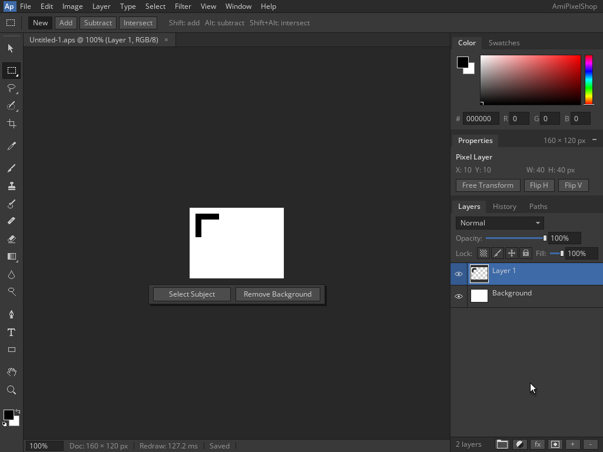
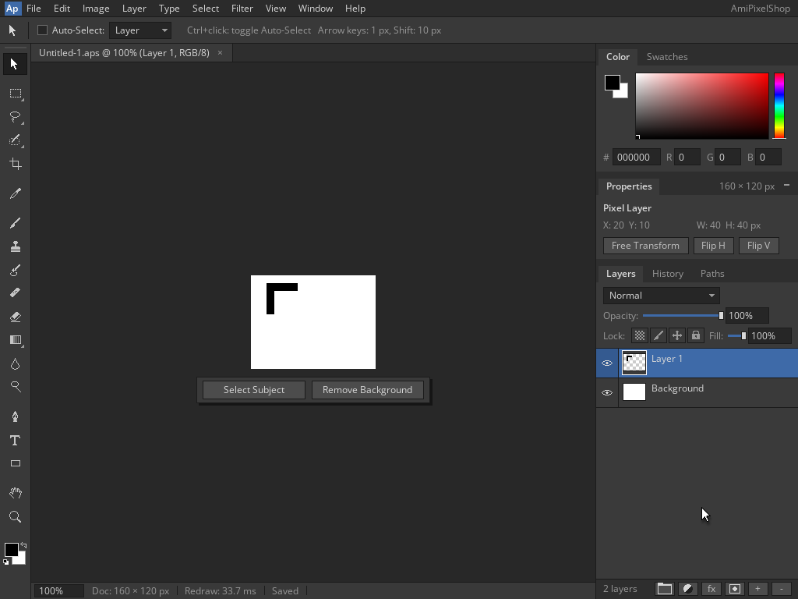

<!--
Copyright (C) 2026, The AROS Development Team. All rights reserved.
Author: Michele Dipace (@kaffeine1)
-->

# AmiPixelShop 68k layered project roundtrip on AROS ARM64

On 2026-11-02 UTC, AmiPixelShop 0.6.1 built for a 68020 without an FPU
completed a layered APX1 save, reopen, edit and resave with the Kaffeine
JIT on AROS ARM64 in QEMU's Raspberry Pi 3 model. The first execution ran
from Shell; a fresh actual `Run` opened the saved project. Both returned
0 with empty standard error and closed cleanly with Ctrl+Q, without a
Quit dialog.

This follows the [horizontal layer flip check](../amipixelshop-layer-flip-2026-11-02/README.md)
with the same executable and library. Workbench and the application
screen were 1024x768, 24-bit. The document was 160x120 at 100% zoom;
the AROS guest was uniprocessor and QEMU used one TCG worker.

## Original frames and project files

| Execution | State | Frame |
| --- | --- | --- |
| Shell | Black L on transparent Layer 1 over white Background | [Baseline](baseline-shell.png) |
| Shell | Save As to the default `Untitled-1.aps` path | [Save dialog](save-dialog.png) |
| Shell | First project saved, clean tab | [Saved](saved.png) |
| Fresh Run | Open the one saved project | [Open dialog](open-dialog.png) |
| Fresh Run | Original project loaded, clean tab | [Reopened](reopened.png) |
| Fresh Run | Loaded Layer 1 moved ten pixels right, modified tab | [Moved](moved.png) |
| Fresh Run | Ctrl+S resave, clean tab | [Resaved](resaved.png) |

Download the actual native project files:

- [before-edit.aps](before-edit.aps): the first saved project, preserved
  byte for byte by native DOS Copy outside `Work:` before Run started.
- [after-move.aps](after-move.aps): the existing project after the loaded
  Layer 1 was moved and Ctrl+S completed.

Both files are 357 bytes. Their different hashes and decoded layer data
distinguish the first save from the resave. The download names identify
the two states; the application's path remained `Work:Untitled-1.aps`.
These are the test drawing's native files, not application binaries.

## Workflow and independent validation

The first execution keeps the initial two layers. Two black rectangle
fills create an asymmetric L on transparent Layer 1 while Background
stays white. Ctrl+Shift+S opens the native ASL Save As requester, and
Return saves `Untitled-1.aps`. After the application exits, native DOS
Copy preserves the first file and returns 0 with empty error output.

The fresh Run execution uses Ctrl+O and selects the saved file in the
native Open requester. The loaded project retains both layers, with
Layer 1 active. The Move tool and Shift+Right translate that layer ten
pixels right. Ctrl+S writes the existing path directly; no second ASL
requester appears. The modified tab becomes clean and the status shows
Saved before normal Ctrl+Q exit.

Independent decoding of both extracted files verifies:

- APX1 version 3, 160x120 dimensions, two layers and active layer 1.
- The `Background` and `Layer 1` names, layer properties and exact tile
  presence maps, without flattening the project.
- All six Background tiles are opaque white, including tile padding.
  Layer 1 has one present tile, with exact raw RGBA and padding matching
  the independent reference before and after the move.
- Layer 1 contains 700 opaque-black canvas pixels and 18,500 transparent
  canvas pixels. Its transparent pixels and the separate white
  Background survive both files.
- No optional chunks or bytes after the end of either document.

Five original canvas regions, `(322,353)..(482,473)` with exclusive
right/bottom bounds, also match references built from fixed coordinates:

- Before the move, the top bar is black at `[10,50) x [10,20)` and the
  stem at `[10,20) x [20,50)`.
- After the move, those rectangles are `[20,60) x [10,20)` and
  `[20,30) x [20,50)`. Background is unchanged.
- Each composite has 700 black pixels, 18,500 white pixels and 57,600
  RGB bytes. Exactly 800 pixels change in the translation.
- Baseline, saved and reopened match the original reference exactly;
  moved and resaved match the translated reference exactly.

No captured frame supplies the expected pixels. The original composite
RGB SHA-256 is
`e68e0231b2abf21cd4bf475489653508b0c80bff7273b8e62d26773294565b83`.
The moved composite RGB SHA-256 is
`2b0d873fab2d64b717b3cade6af510dedb9459aa0e0e3c77ac7b440f31e262dd`.

Both execution traces identify the Kaffeine JIT. Shell records 4,070
blocks / 20,613 translated instructions; Run records 3,796 blocks /
19,339 translated instructions. These counters identify the executions;
they are not a performance benchmark.

## Scope and identity

This checks one controlled two-layer project with a transparent
foreground, fresh-process reload, one horizontal move and an existing-path
resave. It does not establish arbitrary transparency, all layer features,
new-path resaving, other formats, the original FPU release, Moira or
physical-hardware compatibility. Undo was not part of this session.

- AmiPixelShop SHA-256:
  `14f5d373e46d5665f89f08eb827caf33949346761d44b69fdf516c2ebbbdab4d`.
- `kaffeine.library` SHA-256:
  `8af7929c322e4c7a06342a48a24eec97d61945fe8098cd88f9b02c174ff519ce`.

The VM is closed. Only the seven original planned frames and the two
native test projects are included; application binaries and disk images
are not distributed.

| File | Bytes | SHA-256 |
| --- | --- | --- |
| baseline-shell.png | 42,606 | `b2df0d64433fc56151f0b16d10145feb8a8b4d988c3b7dfa3c6a71b50ba4e3e9` |
| save-dialog.png | 44,011 | `d35b4ab3ff0673d77b5336b4f4e4cdba3e82009b6cff02ee359dfd0ea7d1a6a9` |
| saved.png | 43,006 | `d26aac008862946bbeb1ece2668aff5f6f8a0c3feb11642ed90d9008d9f8f728` |
| open-dialog.png | 42,452 | `f07564bda71c634b0cd6cc053dd7e642f2621ea400a03832059917cd66be418e` |
| reopened.png | 40,041 | `d959078cafba697f5a87039354e9da46a3c1befb2345b8f5bb36aad7c7a7b4f8` |
| moved.png | 43,910 | `14d579c83f844606584170247597b332ef78118ffc78f6b43c64a74570fb97d6` |
| resaved.png | 43,947 | `eed345bc287db8fec19c222af510997111e39e363e82e3ba32efddbf7a5ddc50` |
| before-edit.aps | 357 | `e509c4adfad92a33f8b192f0c48beff76295b22f57f425b4e086189dd762bd7c` |
| after-move.aps | 357 | `285d57c5259caac72a60c32a7762ad16e66211c9e9cd566e65324b6085714b2e` |

AmiPixelShop is by radi7777; its original
[MIT license and copyright notice](../amipixelshop-2026-11-01/AmiPixelShop-LICENSE.txt)
are retained unchanged.

A [later recorded JIT demonstration](../amipixelshop-jit-2026-11-02/README.md)
shows this workflow through two real native CLI desktop icons, with
same-session backend messages and completion counters.
