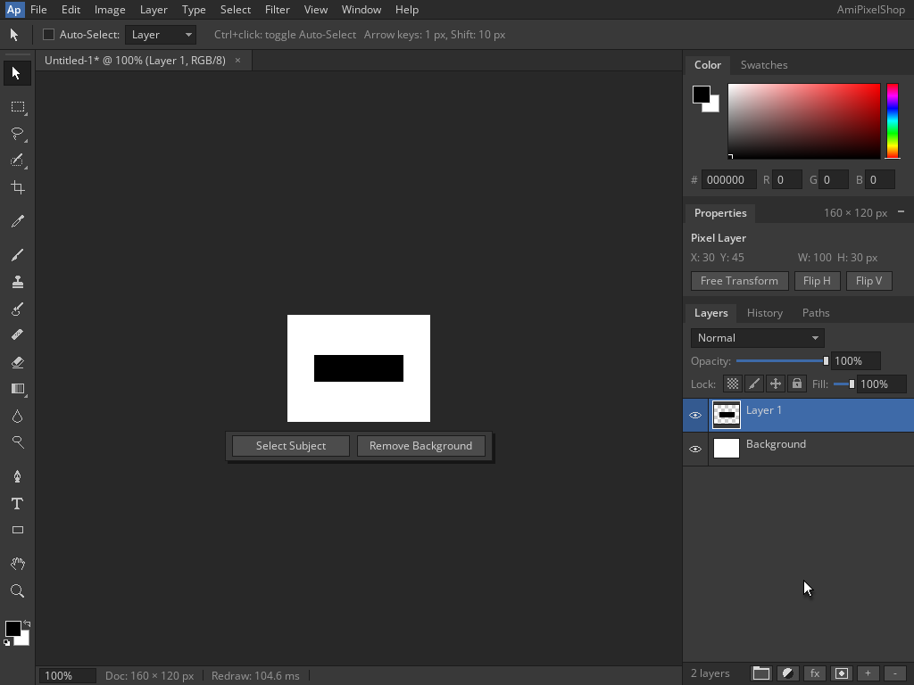

<!--
Copyright (C) 2026, The AROS Development Team. All rights reserved.
Author: Michele Dipace (@kaffeine1)
-->

# AmiPixelShop 68k Move and Undo on AROS ARM64

On 2026-11-02 UTC, AmiPixelShop 0.6.1 built for a 68020 without an FPU
moved a painted layer and undid the move using the Kaffeine JIT on AROS
ARM64 in QEMU's Raspberry Pi 3 model. A fresh Shell execution and a fresh
actual `Run` repeated the same workflow. Both returned 0 with empty
standard error and closed normally.

Workbench and the application's screen were 1024x768, 24-bit. The document
was 160x120 at 100% zoom; QEMU used one TCG worker. This uses the unchanged
executable and library from the [JPEG save/reopen check](../amipixelshop-jpeg-2026-11-02/README.md).

## Original frames

| State | Shell | Fresh Run |
| --- | --- | --- |
| Rectangle before Move | [Baseline](baseline-shell.png) | [Baseline](baseline-run.png) |
| Layer moved ten pixels right | [Moved](moved-shell.png) | [Moved](moved-run.png) |
| Canvas restored by Undo | [Restored](restored-shell.png) | [Restored](restored-run.png) |
| Native unsaved-changes Quit dialog | [Quit](quit-shell.png) | [Quit](quit-run.png) |

Each fresh document keeps its white Background and initial Layer 1.
Rectangle selection, black fill and deselection paint a 100x30 rectangle
on Layer 1. The Move tool and Shift+Right shift it ten pixels right;
Ctrl+Z restores the original canvas. The pointer remains outside the canvas.
Ctrl+Q opens the native Quit dialog; Left Amiga+V confirms Quit. Both
application screens close and both real application return codes are 0.

The restored frames still display X=40 in the Properties panel even though
the canvas has returned to X=30. The following Quit frames display X=30.
This is an observed panel-refresh limitation; the canvas result below is
measured independently of that caption.

## Independent pixel validation

After shutdown, the canvas region `(322,353)..(482,473)` (exclusive
right/bottom) in each original baseline, moved and restored PNG was decoded
and compared with a reference built directly from fixed coordinates:

- Baseline and restored: black at `[30,130) x [45,75)`, white elsewhere.
- Moved: black at `[40,140) x [45,75)`, white elsewhere.
- Every frame: 3,000 black pixels, 16,200 white pixels and 57,600 RGB bytes.
- Move changes exactly 600 pixels: two 10x30 strips. Undo restores every
  original canvas byte, with zero tolerance, in both executions.

No earlier JIT frame supplies the expected pixels. The reference and actual
baseline/restored RGB SHA-256 is
`4492ff3a9967713dd9148f8014390bc8a873e5eaf0bb7046fdc8ce920a1c0078`.
The reference and actual moved RGB SHA-256 is
`b2724d26dfa9420820146d0f06181141ee422eb94ccf41a9dfb9e06640911458`.

Both execution traces identify the Kaffeine JIT and record 3,757 blocks /
18,139 translated instructions. These counters identify this test; they
are not a performance benchmark.

## Scope and identity

This checks the selected two-layer opaque composite, one rectangle fill,
one horizontal keyboard move, one Undo and native Quit in both launch
modes. It does not establish arbitrary layer transforms, transparency
editing, complete panel refresh, further Undo/Redo sequences, the original
FPU release, Moira or physical-hardware compatibility. No file save was
part of this session; the separate format checks cover save and reopen.

- AmiPixelShop SHA-256:
  `14f5d373e46d5665f89f08eb827caf33949346761d44b69fdf516c2ebbbdab4d`.
- `kaffeine.library` SHA-256:
  `8af7929c322e4c7a06342a48a24eec97d61945fe8098cd88f9b02c174ff519ce`.

The VM is closed. Only the eight original planned frames are included;
application binaries and disk images are not distributed.

| File | SHA-256 |
| --- | --- |
| baseline-shell.png | `a2929dc371266f293260a51f278ad0351f33531405217a7a1985d019650ed70c` |
| moved-shell.png | `e3fba6471ff04f7268b02abff6d48651268ad15bf47d3d6cd5a884e9b8ffe3e7` |
| restored-shell.png | `156eeb61e8903d7d6d06b1964525339459790d22521664b58168859dc51b2a6d` |
| quit-shell.png | `8b42ac5b1535cbcf872ce7b2ae8ed4aa5208ab4f29665b31be66fcd7f25f6c58` |
| baseline-run.png | `ca3207072df95928f28e6f59db3bc3c8fe6b95b46a7e00cc91488aa0dd1e7b93` |
| moved-run.png | `71ea4646e6058dc97652d5f548db08787d9111d340551d4685944124146b149c` |
| restored-run.png | `c4d15565ec7b3870ea4ea49ccad6b8fd712f79fb839f5e42b3f967f148ec32b7` |
| quit-run.png | `8d406aebbaad9fd9cacbc4f4fe65d66cc4d60bbd3884135ac06245f93039623b` |

AmiPixelShop is by radi7777; its original
[MIT license and copyright notice](../amipixelshop-2026-11-01/AmiPixelShop-LICENSE.txt)
are retained unchanged.
