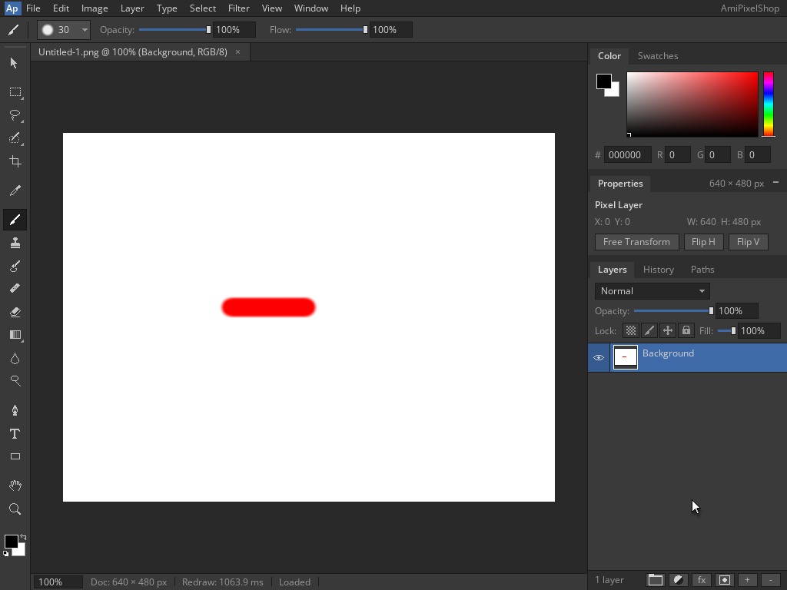

<!--
Copyright (C) 2026, The AROS Development Team. All rights reserved.
Author: Michele Dipace (@kaffeine1)
-->

# AmiPixelShop 68k PNG save and reopen on AROS ARM64

On 2026-11-02 UTC, AmiPixelShop 0.6.1 built for a 68020 without an FPU
saved a red brush stroke as PNG from Shell and reopened it through actual
`Run`, using the Kaffeine JIT on AROS ARM64 in QEMU's Raspberry Pi 3 model.
Workbench and the application's own screen were 1024x768, 24-bit. The document
was 640x480 at 100% zoom; QEMU used one TCG worker.

This extends the [layered APX1 stroke check](../amipixelshop-colour-2026-11-01/README.md)
with a single opaque Background and RGB PNG.

## Frames and saved PNG

1. [Red selected: R 255, G 0, B 0](red-selected.png)
2. [Stroke on the opaque Background](red-stroke.png)
3. [Save As before changing the extension to .png](save-dialog.png)
4. [Saved PNG](saved.png)
5. [Open listing the 3,369-byte PNG](open-dialog.png)
6. [Loaded PNG in the fresh Run execution](reopened.png)

[Download the actual 640x480 PNG](red-stroke-640x480.png).

The empty Layer 1 was merged down before drawing, leaving the white
Background. A size-30 brush with full opacity and flow drew the same pointer
path as the APX1 check: canvas (218,227) to (318,227). Save As changed the
filename from `Untitled-1.aps` to `Untitled-1.png`. The application displayed
Saved, exited, then displayed Loaded after Open in a fresh `Run` execution.
Both executions returned 0 with empty standard error, recorded the Kaffeine
JIT backend and completed translation counters, and closed cleanly.

Each resulting document has one Background layer. Its Properties bounds are
the full 640x480 Background; the stroke's nonwhite bounds are separately
(203,212)..(331,241), inclusive (129x30). The cursor was parked outside the
canvas. The fresh execution's foreground colour resets to black while the
red pixels in the document persist.

## Pixel validation

The file was extracted after shutdown and checked independently:

- PNG signature; 640x480, 8-bit RGB, noninterlaced.
- Exactly IHDR, one IDAT and IEND, valid chunk lengths and CRCs, exact EOF.
- One complete zlib stream, exact scanline length and no compressed tails.
- Decoded RGB matches the expected white-background paint arithmetic.
- The saved and reopened 640x480 canvas RGB regions are byte-identical and
  both match the decoded PNG, with 3,658 nonwhite stroke pixels.

The 921,600-byte RGB SHA-256 for the PNG and both screen regions is
`57114c5d89f7f322616329b5f6c02790f925cce976eeeecd2ff3eb99ad1a57a5`.

The expected pixels use the alpha coverage from the
[previously saved APX1 stroke](../amipixelshop-colour-2026-11-01/red-stroke-640x480.aps).
For each coverage value A, the source's paint arithmetic over opaque white
predicts white when A is zero; otherwise R is 254 and
`G = B = (255 * (255 - A) * 257) >> 16`, with output alpha 255.
That prior coverage was itself produced by the JIT: it supplies a reference
independent of the new PNG, rather than an independent brush or CPU
implementation. The full RGB comparison verifies the new export and reload
against that coverage and the source colour arithmetic.

## Scope and identity

This checks one stroke painted directly on an opaque Background, RGB PNG
Save As and fresh Run Open. PNG transparency, export of an unmerged layered
document, merge after painting, other tools, JPEG/IFF, the first-start mode
requester, Moira and physical hardware remain separate checks.

The source-built 68k executable and library are unchanged from the APX1 check:

- AmiPixelShop SHA-256:
  `14f5d373e46d5665f89f08eb827caf33949346761d44b69fdf516c2ebbbdab4d`.
- `kaffeine.library` SHA-256:
  `8af7929c322e4c7a06342a48a24eec97d61945fe8098cd88f9b02c174ff519ce`.

The original FPU release's startup result is documented separately in
[classic application checks](../../classic-applications.md).

| File | SHA-256 |
| --- | --- |
| open-dialog.png | `3ebe24224342cab305d8679f464bc89b2a2108f820def23796537df8812cc2bf` |
| red-selected.png | `4f0c3cc53ef2160264b0eedc31727c1f854b6f57ca552c2783c33d1b3a020f01` |
| red-stroke-640x480.png | `804d2ed3a37ecde41ba6ee3db4643e8fbc2efd24618a677d2a744d7651328e6e` |
| red-stroke.png | `9b2c0d245a8ecc9b751671446c757f15f2cfef99fec9312bae18fce9a6f2c509` |
| reopened.png | `1a5447d0d1a1ec340d61b01ffe4c03d2e81a92b026472d6cc166cd75655cfea7` |
| save-dialog.png | `a2fe7e97d8639157cf3f96bc33e4c1520abbd3077adf0af10dedd2f4f90d88e4` |
| saved.png | `d1c718a1f7edec379f579a7fabb9d65ef8f3bd65e50945902bc7a894c5f7a101` |

AmiPixelShop is by radi7777; its original
[MIT license and copyright notice](../amipixelshop-2026-11-01/AmiPixelShop-LICENSE.txt)
are retained unchanged. These are original frames and the actual saved PNG.
