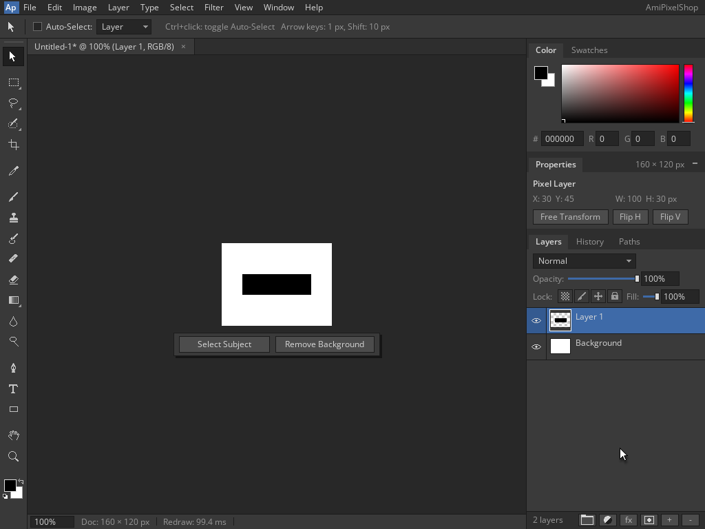

<!--
Copyright (C) 2026, The AROS Development Team. All rights reserved.
Author: Michele Dipace (@kaffeine1)
-->

# AmiPixelShop 68k Move, Undo and Redo on AROS ARM64

On 2026-11-02 UTC, AmiPixelShop 0.6.1 built for a 68020 without an FPU
completed a Move, Undo and Redo sequence with the Kaffeine JIT on AROS
ARM64 in QEMU's Raspberry Pi 3 model. A fresh Shell execution and a fresh
actual `Run` repeated the same workflow. Both returned 0 with empty
standard error and closed normally through the native Quit dialog.

This extends the [Move and Undo check](../amipixelshop-move-undo-2026-11-02/README.md)
with one Redo, using the same executable, library and fixed geometry.
Workbench and the application's screen were 1024x768, 24-bit. The document
was 160x120 at 100% zoom; QEMU used one TCG worker.

## Original frames

| State | Shell | Fresh Run |
| --- | --- | --- |
| Rectangle before Move | [Baseline](baseline-shell.png) | [Baseline](baseline-run.png) |
| Layer moved ten pixels right | [Moved](moved-shell.png) | [Moved](moved-run.png) |
| Undo restores the original canvas | [Undone](undone-shell.png) | [Undone](undone-run.png) |
| Redo restores the moved canvas | [Redone](redone-shell.png) | [Redone](redone-run.png) |
| Native unsaved-changes Quit dialog | [Quit](quit-shell.png) | [Quit](quit-run.png) |

Each fresh document keeps its white Background and initial Layer 1.
Rectangle selection, black fill and deselection paint a 100x30 rectangle
on Layer 1. With the Move tool active, Shift+Right moves it ten pixels
right, Ctrl+Z undoes the move, and Ctrl+Shift+Z redoes it. No edit intervenes
between Undo and Redo; the cursor remains outside the canvas. Ctrl+Q opens
the native Quit dialog, and Left Amiga+V confirms Quit. Both application
screens close and both real application return codes are 0.

## Independent pixel validation

After shutdown, the canvas region `(322,353)..(482,473)` (exclusive
right/bottom) in all eight state PNGs was decoded and compared with a
reference built directly from fixed coordinates:

- Baseline and undone: black at `[30,130) x [45,75)`, white elsewhere.
- Moved and redone: black at `[40,140) x [45,75)`, white elsewhere.
- Every frame: 3,000 black pixels, 16,200 white pixels and 57,600 RGB bytes.
- Each Move/Undo/Redo transition changes exactly 600 pixels in two 10x30
  strips. Undo restores the original canvas; Redo restores the moved canvas
  byte for byte, with zero tolerance, in both executions.

No prior captured frame supplies the expected pixels. The reference and
actual baseline/undone RGB SHA-256 is
`4492ff3a9967713dd9148f8014390bc8a873e5eaf0bb7046fdc8ce920a1c0078`.
The reference and actual moved/redone RGB SHA-256 is
`b2724d26dfa9420820146d0f06181141ee422eb94ccf41a9dfb9e06640911458`.

Both execution traces identify the Kaffeine JIT and record 3,768 blocks /
18,177 translated instructions. These counters identify the executions;
they are not a performance benchmark.

## Scope and identity

This checks one horizontal Move, one Undo, one Redo and native Quit for the
selected two-layer opaque composite in both launch modes. It does not
establish arbitrary transforms, transparency editing, longer history
sequences, the original FPU release, Moira or physical-hardware compatibility.
No file save was part of this session; the separate format checks cover
save and reopen.

- AmiPixelShop SHA-256:
  `14f5d373e46d5665f89f08eb827caf33949346761d44b69fdf516c2ebbbdab4d`.
- `kaffeine.library` SHA-256:
  `8af7929c322e4c7a06342a48a24eec97d61945fe8098cd88f9b02c174ff519ce`.

The VM is closed. Only the ten original planned frames are included;
application binaries and disk images are not distributed.

| File | SHA-256 |
| --- | --- |
| baseline-shell.png | `f5e3a49c8bd13d9fdb9233fdbe2533d02d6ae047a59f87c8e1c83b4875227bb0` |
| moved-shell.png | `0f9b9c656c677dc0e3f36f3dea68204fc5e05596e1ea045fb5b258669e8851c9` |
| undone-shell.png | `f72b490bee4fea3344911144487b27cfd72a7bb0fe9f29d9b450afa8b894306e` |
| redone-shell.png | `e5c1915b502256d64032c069548d863f68b602e35ada10dce4df9cd908c46941` |
| quit-shell.png | `07d82d9b1f5d64ffd09a605903037c4f88e36e86306317b497111de55174e577` |
| baseline-run.png | `bd147b06dbff44120958f28ca165316dd897aee1a921a78a9963250f03e0a9cd` |
| moved-run.png | `35c3868abec69c3eb9b2f519c46bcaa32258da4a32f2c4dc0c2ac86db736e122` |
| undone-run.png | `0328300b38ec3d14f6fba991b3b140c18102137f36a367b05238bba6d158a79c` |
| redone-run.png | `a28791d305780536b9d70b95c832541c60a60d92907ab1f101637653844c3304` |
| quit-run.png | `33f11fdbadf136082369f53f2dfd71eb3f975bebc65f99c5a2061d31094a59c2` |

AmiPixelShop is by radi7777; its original
[MIT license and copyright notice](../amipixelshop-2026-11-01/AmiPixelShop-LICENSE.txt)
are retained unchanged.
