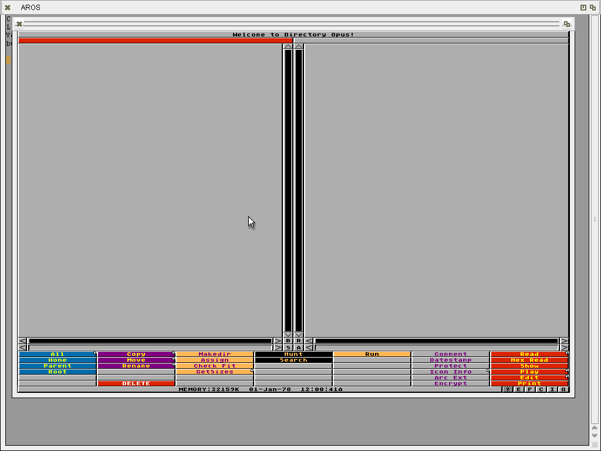

<!--
Copyright (C) 2026, The AROS Development Team. All rights reserved.
Author: Michele Dipace (@kaffeine1)
-->

# Directory Opus clock display with the Kaffeine JIT

On 2026-11-02, the unchanged 68k Directory Opus 4.12 JR displayed the native
AROS guest's date and time after the [CurrentTime fix (PR #92)](https://github.com/kaffeine1/kaffeine/pull/92).
These are original 1024x768 guest frames from Shell and a fresh actual `Run`
on AROS ARM64 in QEMU; both executions returned 0 with empty standard error.

| Execution | Displayed date | Displayed clock | Allowed guest seconds after midnight | Original frame |
| --- | --- | --- | --- | --- |
| Shell | `01-Jan-78` | `12:00:25A` | 15–35 | [Clock from Shell](clock-shell.png) |
| Fresh Run | `01-Jan-78` | `12:00:41A` | 34–51 | [Clock from Run](clock-run.png) |

The allowed intervals come from native `GetSysTime`/`DateStamp` observations
before and after each capture, including a five-second display-refresh margin.
The guest clock was unchanged and started at its 1978 epoch. This accepts the
shown formatting against native guest time; it does not establish current
civil time, file-date/`Future` labels, Moira clock behavior or physical hardware.

Both executions identify the Kaffeine JIT. Together they use 32 manual
`CurrentTime` calls, with no generated fallback or invalid-output refusal.
Application behavior beyond this clock check is described in the
[classic application notes](../../classic-applications.md).

- Directory Opus SHA-256: `7d61cf62f9eeb860d98af8513c6ea95b34c0ae25397a2d8ad0fc9056ca8ee1f1`.
- `kaffeine.library` SHA-256: `dd793fa9196d3ff28df8256c0663f13010ba61a8b64b59509759aafc5a68b450`.

Only the two original screenshots are included. Executables, disk images and
runtime logs are not distributed.

| File | Bytes | SHA-256 |
| --- | --- | --- |
| clock-shell.png | 10,940 | `2b315eeb0141989513293392eefbcc2556c21f09ddbb148361959ae7fc002b89` |
| clock-run.png | 10,974 | `28d21eaa5bde419156a70fce054606a1ab3b38d2968f9e3ab40a9e11b6e70cb6` |
