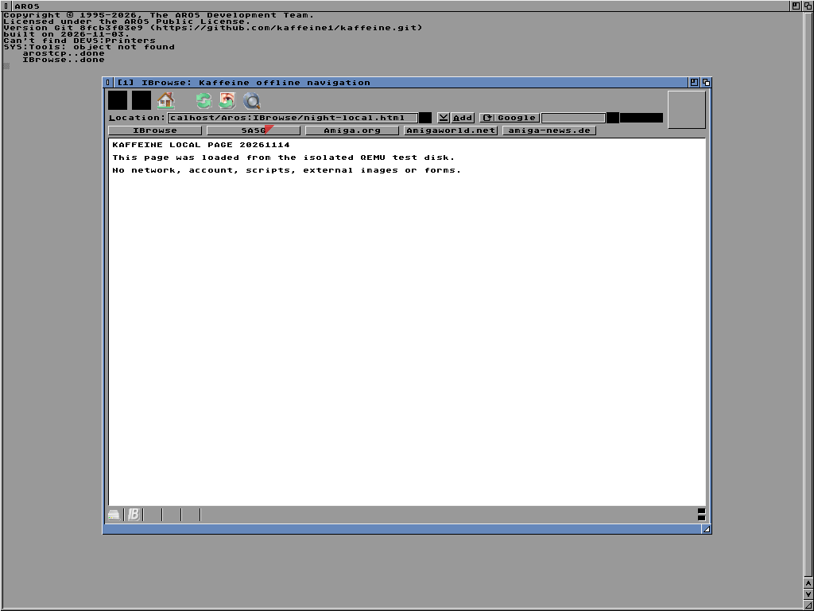
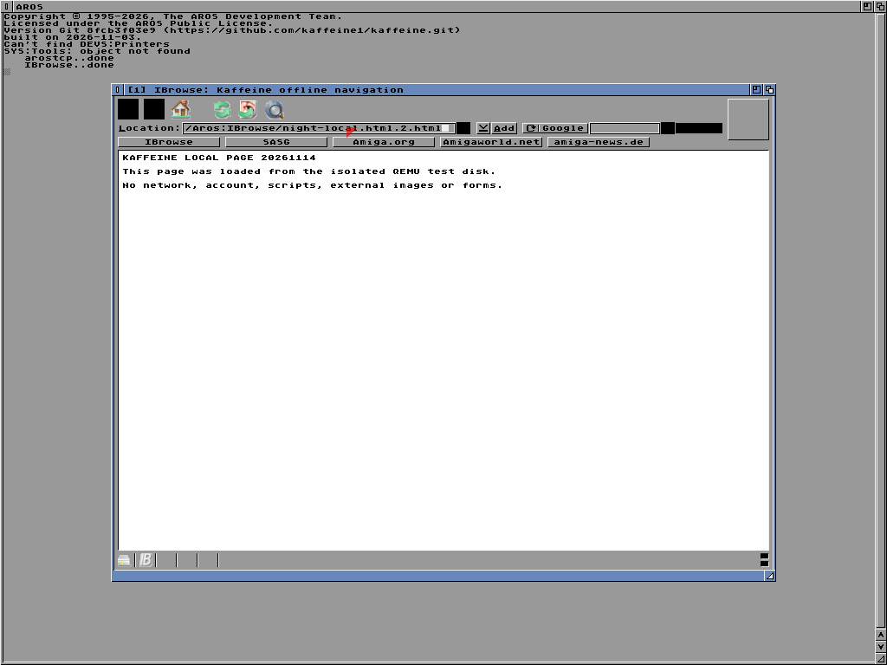
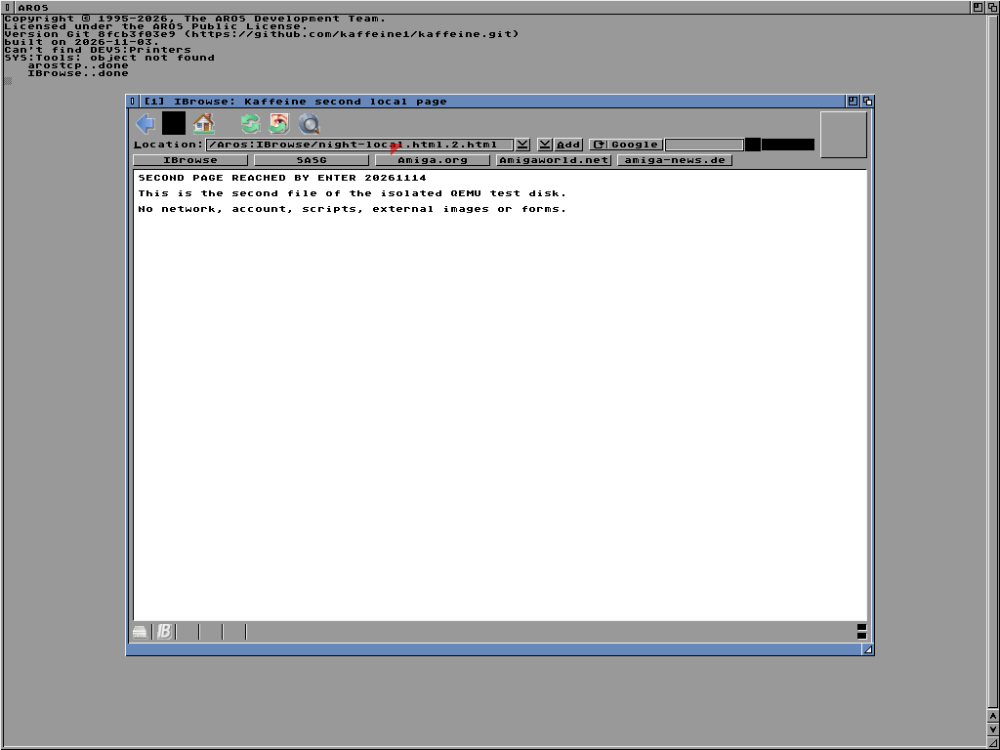
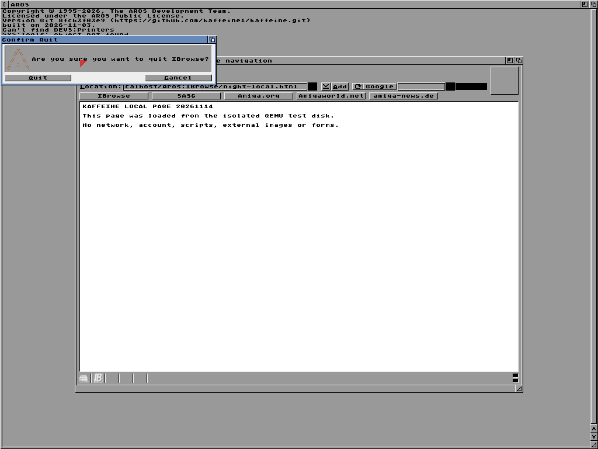
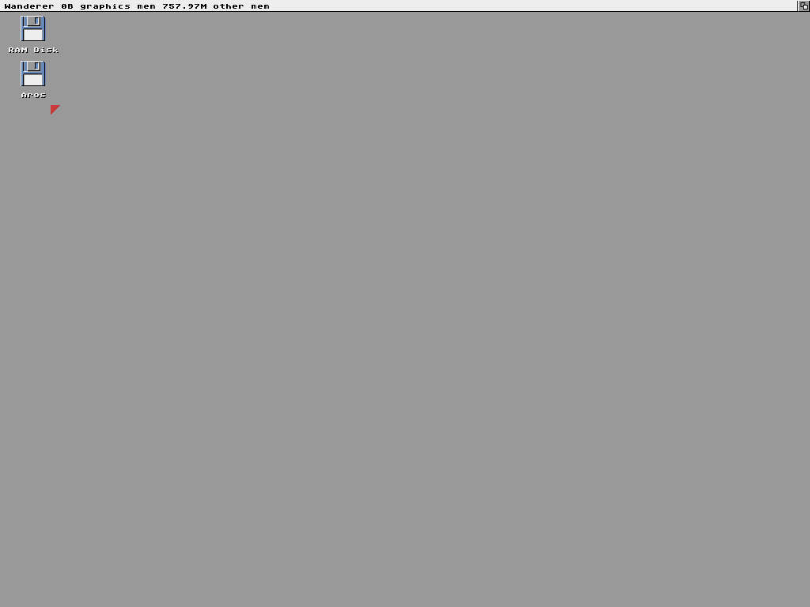

<!--
Copyright (C) 2026, The AROS Development Team. All rights reserved.
Author: Michele Dipace (@kaffeine1)
-->

# IBrowse 68k: local pages and normal Quit on a local development build

On 2026-11-14 the original 68k IBrowse 3.0a (version string 30.8) with the
original 68k MUI 3.8 (`muimaster.library` 19) opened a local page, took a
typed address, loaded a second local file on Return and, in a separate
execution, quit normally through its own requester. These are original
1024x768 guest frames from AROS ARM64 in QEMU with the Kaffeine JIT.

**These frames do not show the code published in this repository.** The
`kaffeine.library` used here is a local development build. It contains
guest task scheduling changes that are not published, including the change
that the normal Quit depends on. I have not repeated these checks with the
published code.

## Navigation execution

IBrowse was started from the Shell on a static HTML file of the test disk.
The frame follows the acknowledgement of its start requester.

After a click in the Location field and Shift+Right, the seven characters
`.2.html` were typed. They append to the address of the first page.

Five seconds after Return, the window title and the page body are those of
a second static file on the same disk. The browser was left open and this
execution ended at its time limit: it is not an exit test.

## Quit execution

In a separate execution with only the first page loaded, closing the window
opened IBrowse's own Confirm Quit requester.

After the Quit button the browser window is gone and the Shell command
returned 0 with an empty error stream. No execution combines navigation
and Quit.

## Setup and limits

The guest ran on QEMU's Raspberry Pi 3B model with one TCG thread and no
network device. Both pages are my own static test files: no scripts,
images, forms or external references. Mouse and key events were injected
through the QEMU monitor, and each step was sent only after the current
frame equalled a previously reviewed reference frame.

The boot banner visible in the frames reports the identifier `8fcb3f03e9`
and the date 2026-11-03. That is what the banner says; it does not by itself
establish an unmodified build of that commit. The boot package and
`kaffeine.library` are later local development builds. The trace identifies
the Kaffeine JIT, with no bridge stop.

- `kaffeine.library` SHA-256: `fde55343866c5f2eaa0d174ad96a27d7f974cb7a74cbcef83b316ded86625a1f`.

This accepts, on that local development build, a Shell start on a local page,
typed text in the address field, a second local page on Return and, in a
separate execution, a normal Quit with return code 0. It does not establish
the same with the published code, a start through `Run` or Workbench,
network access or any web site, links, history, images or scripts, a Quit
after navigating, repeated executions, the Moira backend, current AROS
mainline or physical hardware.

Only the five original screenshots are included. IBrowse, MUI, disk images
and runtime logs are not distributed.

| File | Bytes | SHA-256 |
| --- | --- | --- |
| local-page.png | 17,004 | `32d4290e7b848ce31ff55c0e1b25f7318dac190416983bf73f9107ec48e1285a` |
| url-typed.png | 17,036 | `106260ee5e3fec366a3dedabf38a9eff19da59af5cafc280ff3b2bfe9a246ecc` |
| second-page.png | 17,518 | `7b13cd802e25dfa3131fddc6f1cbff32f1f753cb9fc7acee823116aab272b6eb` |
| confirm-quit.png | 12,964 | `8ae8983a4ca53fbff5d96ab70220aac4b10976233e8a890f657e072f2e7abe91` |
| desktop-after-quit.png | 5,497 | `d9d718bf360379d9339660c171f69888f34967d002b94ecc8c91f5fec488abf2` |
