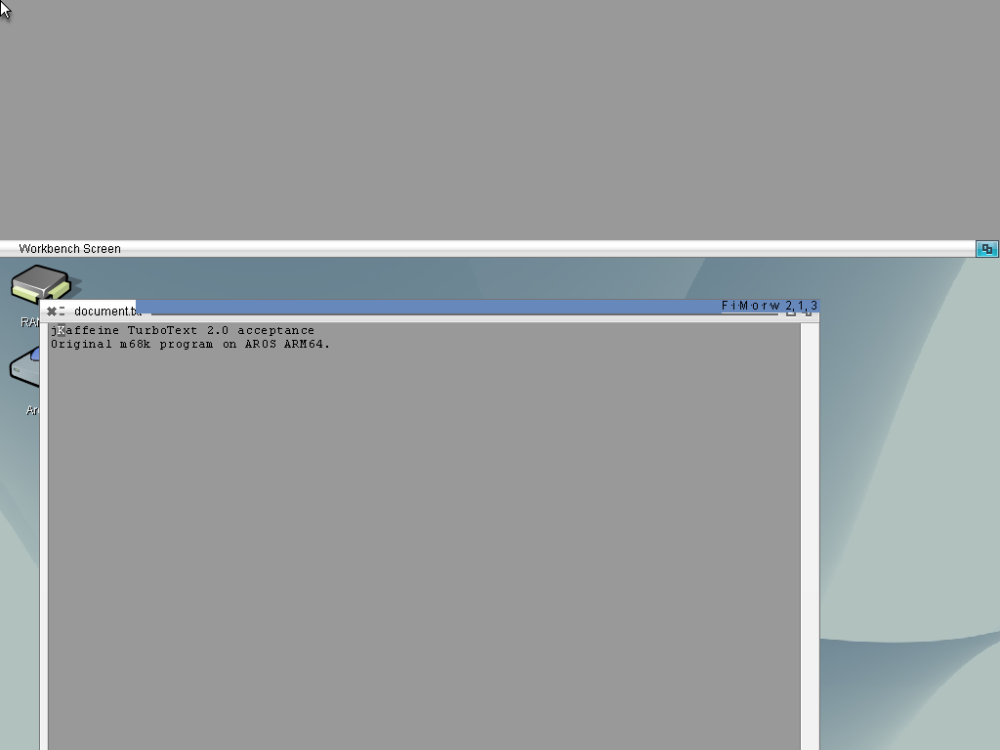

# TurboText 2.0 on AROS ARM64

These are complete guest framebuffer captures from the unmodified 68k
TurboText 2.0 distribution running through `kaffeine.library` with the primary
Kaffeine JIT. The target is a uniprocessor AROS ARM64 kernel in QEMU's
Raspberry Pi 3 model, with one TCG worker. Native bitmap queries confirmed
Workbench at 1024x768, 24-bit.

The original launcher opens the sample document and displays both lines.
The test then delivers one `j` key: it appears at the start of the document,
the cursor advances to column 2 and the modified indicator changes.

This accepts opening, document loading and one-character input. Save/reopen,
shortcuts, keyboard layouts and broader editor behavior are not accepted by
these images. The typed keymap path was selected; no generated raw-event
fallback, bridge refusal or CPU fault appeared in this run.

The images retain an existing native AROS limitation: `SPOS_MAKEVISIBLE`
incorrectly shifts Workbench down, including during input. A separate native
indexed-to-truecolor conversion defect also remains. See the
[application status and display limits](../../classic-applications.md).

After VM shutdown, installed application, emulator library and observation
helpers matched their original artifacts. Runtime source is `ec55273998`;
the tested ARM64 library SHA-256 is
`d70ac5287b2537af0c31f8c3471c5d15a14128559dea04ad024843dd8e340671`.
Application binaries and private disk images are not distributed here; the
[application notes](../../classic-applications.md) link the original archive
and installation instructions.
