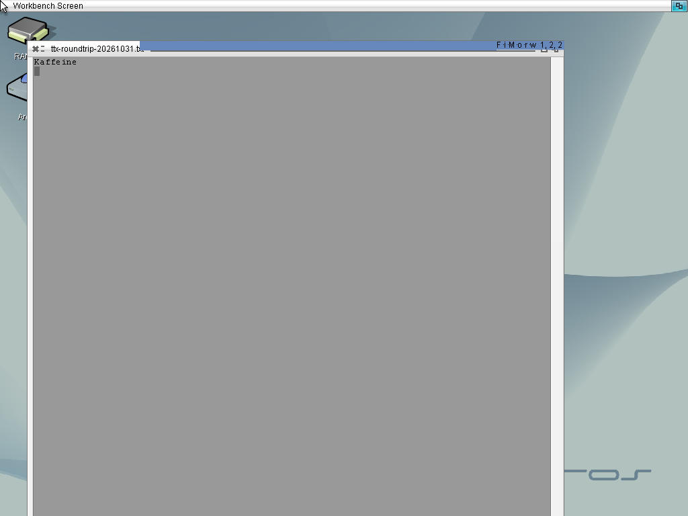

<!--
Copyright (C) 2026, The AROS Development Team. All rights reserved.
Author: Michele Dipace (@kaffeine1)
-->

# TurboText 68k save and reopen on AROS ARM64

On 2026-10-31, the original TurboText 2.0 launcher and its three support
libraries ran unmodified through the Kaffeine JIT on AROS ARM64. Workbench
was 1024x768, 24-bit, using the Raspberry Pi 3 model in QEMU with one TCG
worker and a uniprocessor AROS kernel.

The first `TTX ... WAIT` invocation opened a new document. The test typed
`Kaffeine` followed by a newline, saved it, and closed the editor. A second
original launcher invocation reopened the saved file, displayed that text
without further typing, and closed normally. Both invocations returned 0,
with empty standard error and a completed test sequence. The trace identified
the Kaffeine JIT, with no Moira execution or bridge stop.

After QEMU shut down, the copy retained after the first close and the final
file both contained these exact nine bytes:

```text
4b 61 66 66 65 69 6e 65 0a
```

Both SHA-256 values were
`3d45087c1ddc50b7f6330e05b38a7d4fecfbc4396b38729777eb597beda2b862`.
The ten installed application, bridge, support-library and native setup
artifacts matched their staged hashes after shutdown. The original `TTX`
SHA-256 was
`262399d51c98c3c8498c12e2face18f31c79eb99e68a7a7d302b6b746b6d76c3`.

The checked bridge artifact SHA-256 was
`cc8c42a8ebb33fc2d96e464f68013a9a5c5d2f5bcc1f14e59bf27f2b9fc3f192`.
It includes classic icon writes in guest Processes and the corrected
40-byte reservation for caller-built timer requests. Host regressions and
native cross-compilation are separate from this application observation.




This accepts the nine-byte save/close/reopen workflow through two original
`WAIT` invocations. It does not establish broader editing coverage or a
separate generic `Run` test. Application binaries, support libraries, private
images and runtime logs are not distributed here.
