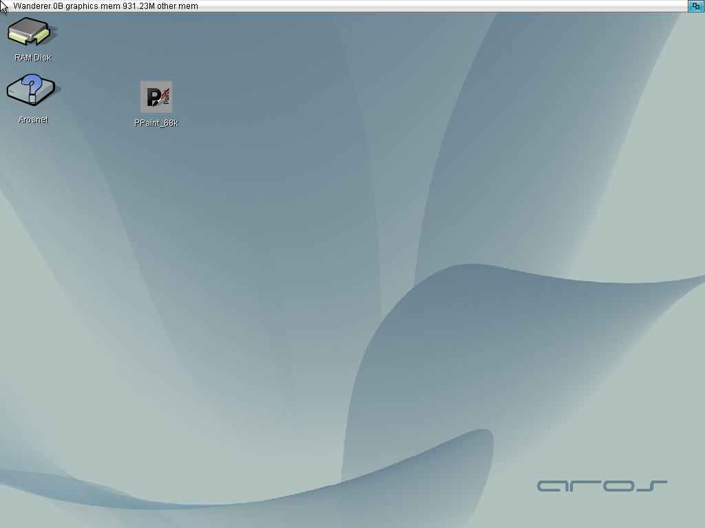
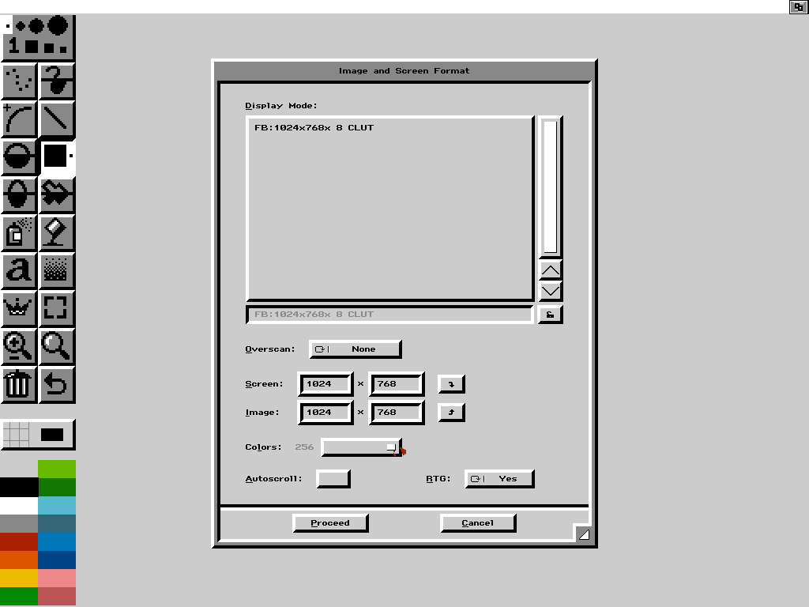
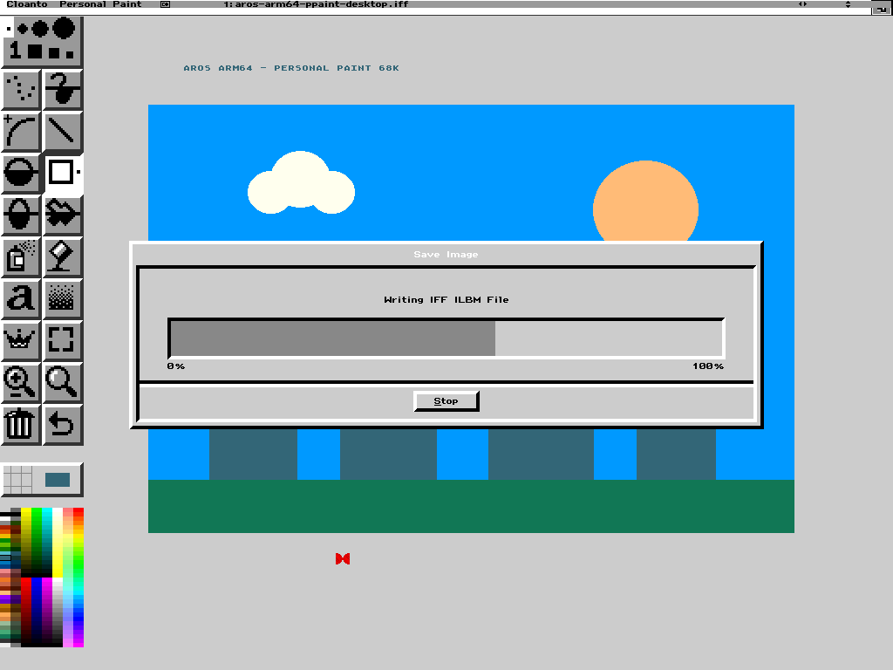

# Personal Paint 68k on AROS ARM64

**Recorded 28 October 2026.** The original Motorola 68k Personal Paint
7.2.1.0 opens from an icon on the native AROS desktop, draws an image,
saves it as IFF/ILBM and returns to the desktop. `kaffeine.library` bridges
the application to native AROS services while Moira interprets its 68k code.

**[Watch or download the video (MP4, 3:41)](media/personal-paint-2026-10-28/personal-paint-68k-aros-arm64.mp4)**

[](media/personal-paint-2026-10-28/personal-paint-68k-aros-arm64.mp4)

The video starts directly on the AROS desktop. It contains only the guest
display, without host window borders or an introductory card. Idle waits
and trial UI selections were cut; the drawing is shown at its original
speed. This edit demonstrates the operations below, not startup time or
end-to-end performance. The “Attention / Memory save mode” requester did
not occur in the recorded session and was not dismissed or hidden by editing.

## What the recording demonstrates

| Step | Observed result |
| --- | --- |
| Desktop | Native AROS Wanderer at 1024×768 with a 24-bit Workbench screen |
| Launch | Double-click on `PPaint_68k`, using the icon's standard `CLI` tooltype |
| Image and screen format | Select 1024×768 and 256 colors inside Personal Paint, independently of the desktop depth |
| Drawing | Use rectangles, circles and text to create the picture in the editor |
| Save | Write `aros-arm64-ppaint-desktop.iff` through the application's IFF/ILBM save operation |
| Exit | Close Personal Paint and return to the native desktop |

QEMU hosts the AROS ARM64 system. The application starts from inside AROS
and uses its native services through Kaffeine; there is no separately
booted AmigaOS system for Personal Paint. This run uses the **Moira
interpreter**, with **CPU blitting**. It does not exercise the Kaffeine JIT
or establish performance or compatibility on physical Raspberry Pi hardware.

## Screenshots

### AROS desktop before launch



### Image and screen format selected in Personal Paint



### Saving the drawing as IFF/ILBM



### Return to the desktop


The editor screenshot above and these four screenshots are lossless guest
captures at 1024×768. The video is H.264 at the same resolution, 24 fps,
221.08 seconds and 975,516 bytes. All media is stored directly in this
repository.

## Inspect the saved drawing

- [Original file saved by Personal Paint: IFF/ILBM](media/personal-paint-2026-10-28/aros-arm64-ppaint-desktop.iff).
- [PNG decoded independently from that file](media/personal-paint-2026-10-28/aros-arm64-ppaint-desktop.png).
- [SHA-256 checksums for the video, screenshots and output files](media/personal-paint-2026-10-28/SHA256SUMS).

The saved file is **87,812 bytes**, with a **1024×768** bitmap, **eight
bitplanes** and a **256-entry palette**. Independent decoding reproduces
every visible canvas pixel in the editor screenshot: the comparison covers
the canvas from `(100, 20)` to `(1024, 768)`, excluding the toolbar. The
drawing uses a small subset of the available palette; 256 colors describes
the selected mode, not the number of distinct colors painted.

## Setup used for this recording

The bridge sources correspond to
[`2bd9ba00c77c5e0edd67cc1fc365d0ed05728ce5`](https://github.com/kaffeine1/kaffeine/commit/2bd9ba00c77c5e0edd67cc1fc365d0ed05728ce5),
which includes the guest memory capacity correction in
[PR #34](https://github.com/kaffeine1/kaffeine/pull/34).
Build and install `kaffeine.library` using the
[library instructions](../../rom/kaffeine/README.md#building) and an AROS
AArch64 image with the Raspberry Pi framebuffer's truecolor and indexed
screen support.

1. Start AROS with Workbench set to **1024×768, 24-bit**.
2. Use a licensed Personal Paint 7.2.1.0 installation with its required
   support libraries. Keep the application executable unchanged.
3. Select `personal_cpu_blit.library` in Personal Paint's startup settings.
   The recorded `PPaint_Prefs/Startup_1.set` uses:

   ```text
   BLITLIBS = "personal_agnus_blit.library", "personal_cpu_blit.library", 0
   ```

   The final `0` selects the alternate CPU library. Agnus custom-chip
   blitter/DMA operation is outside this bridge's current contract.
4. Add the standard `CLI` tooltype to the application's icon and give it
   a 1 MB stack. The icon was left out on the Wanderer desktop and labeled
   `PPaint_68k`; the executable bytes were unchanged.
5. Double-click the icon. In Personal Paint, select the indexed
   **1024×768, 256-color** mode, draw, save as IFF/ILBM and close the app.

The tested executable is **777,824 bytes**, SHA-256
`f6406d103210b7370b55799856c1cffeeac1d6a02e34461dba8d0fb006ebc858`.
The icon label identifies the binary in the video; its checksum identifies
the tested file independently of that label.

The memory correction implements a general Exec contract: direct readers
of the guest `ExecBase.MemList` can see bounded guest heap capacity
descriptors. The former empty list made Personal Paint detect too little
memory. The descriptors exclude reserved areas and expose no native
allocator lists; `AvailMem()` remains the free-space query. This fixes the
false low-memory condition without a Personal Paint executable patch.

## Verified scope and remaining work

The recording establishes icon launch through the **CLI route**, selected
drawing operations, IFF/ILBM saving and a visible return to Wanderer. An
earlier direct Shell run also reported exit code zero; the icon session
does not provide a separate numeric application exit code.

Loading saved 1024×768 IFF and PNG images still reports **“The image is too
large”**. General Workbench `WBStartup` message handling, other painting
operations, complete resource cleanup, responsiveness, application execution
on the Kaffeine JIT and physical hardware validation remain open checks.

The associated bridge regression passed 29 `exec_syslists`, 62 `exec_memory`
and 27 `exec_memheader` checks in both Shell and `Run` on AROS AArch64 in
QEMU. All 47 host executables and three focused ASan/UBSan suites also
passed; leak detection was disabled for those sanitizer runs. These tests
complement the application recording and retain their separate scopes.
See the [current implementation](../../README.KAFFEINE.md) and
[AROS target tests](../../developer/debug/test/kaffeine_target/README.md).

## Media and application credits

The captures show AROS and Cloanto Personal Paint for a compatibility
demonstration. Their interface artwork, names and other third-party
material retain their respective ownership and licenses. The saved drawing
was created during this demonstration. Application executables, licensed
support libraries, ROMs and system disk images are not part of these media
downloads. See [licenses and provenance](LICENSING.md) for the source project.
