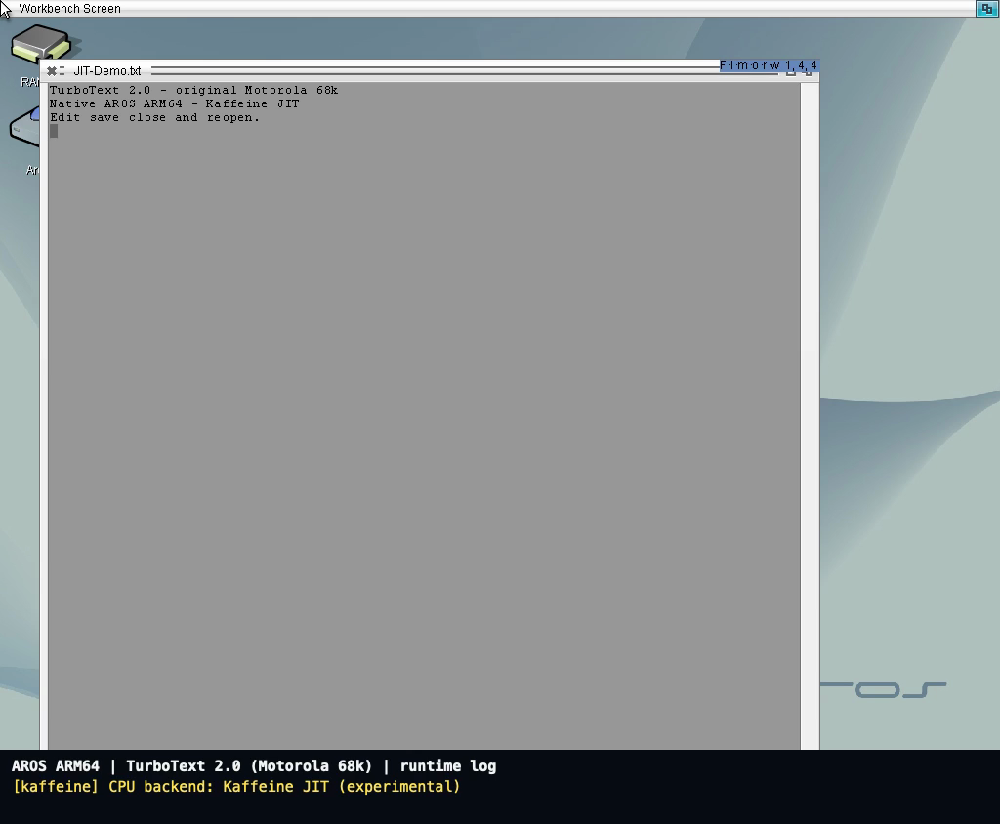

<!--
Copyright (C) 2026, The AROS Development Team. All rights reserved.
Author: Michele Dipace (@kaffeine1)
-->

# TurboText 68k with the Kaffeine JIT on AROS ARM64

**Recorded 31 October 2026.** Original Motorola 68k TurboText 2.0 opens in
native AROS ARM64, edits a document, saves it, closes, and reopens the saved
text without further typing. The application and its three 68k support
libraries are unmodified.

**[Watch or download the video (MP4, 2:18)](media/turbotext-2026-10-31/turbotext-68k-kaffeine-jit-aros-arm64.mp4)**

[](media/turbotext-2026-10-31/turbotext-68k-kaffeine-jit-aros-arm64.mp4)

The video starts directly on the 1024x768, 24-bit AROS desktop, without an
introductory card or host window borders. A separate 76-pixel strip below
the complete guest framebuffer reproduces runtime messages captured during
this same session. The active backend appears on launch; the counters
appear after the launcher finishes:

```text
[kaffeine] CPU backend: Kaffeine JIT (experimental)
[kaffeine] JIT: 174 blocks, 523 translated instructions, 1151 entries
```

Both completed invocations reported those counters. These are the
launcher's reported CPU-context statistics, not an aggregate for every
guest Process or a performance benchmark. Moira was not used in this run.
Idle waits and trial command-field selections were cut; retained editing
is shown at its captured pace.

## Launch and persistence checks

AROS's native Execute dialog starts ordinary AmigaDOS scripts. They set a
1 MiB stack and invoke the original `TTX` with a named file and its standard
`WAIT` option. This is the recorded launch command inside each script:

```text
SYS:EMU68/TTX SYS:EMU68/JIT-Demo.txt WINDOW 40/60/800/600 WAIT
```

The first invocation loads an empty file. Three lines are typed and saved;
the second invocation visibly reloads them. Both original `WAIT` calls
return 0, with empty standard error and completed scripts. After shutdown,
the copy made after the first close and the final file both match all
**99 expected bytes**, including the final newline.

- [Exact text saved by TurboText](media/turbotext-2026-10-31/jit-demo.txt).
- [SHA-256 checksums for the video, poster and saved text](media/turbotext-2026-10-31/JIT-SHA256SUMS).
- [Earlier, separate nine-byte save/reopen test and application/bridge hashes](media/turbotext-2026-10-31/README.md).

The saved text SHA-256 is
`565acd3be3c91d2f7ab46d0737b925efc87f1170e22b1a0ab6548758b5430490`.
All thirteen staged application, bridge, support, setup and script artifacts
match their installed hashes after shutdown. The bridge is the same
`cc8c42a8ebb33fc2d96e464f68013a9a5c5d2f5bcc1f14e59bf27f2b9fc3f192`
artifact used for the earlier test; its 187 compiler source inputs match
the public code.

## Environment and scope

QEMU's Raspberry Pi 3 model hosts AROS using one TCG worker and a
uniprocessor kernel. **Inside AROS, Kaffeine's own JIT executes the 68k
application.** The existing test image includes the native AROS display
fixes described in [the application notes](classic-applications.md#turbotext-progress-2026-10-30);
this is separate from current-mainline or physical Raspberry Pi acceptance.

This accepts the named-file `WAIT` workflow. Desktop icon/non-`WAIT`
process lifetime, unnamed-file Save As, broader editing and indexed-color
composition require separate tests. Application binaries, support
libraries, private images and runtime logs are not distributed here.

The video is H.264, 1024x844, 24 fps, 138.083 seconds and 815,369 bytes.
